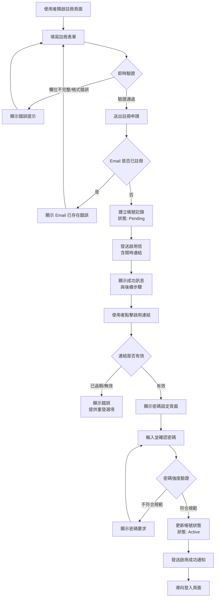
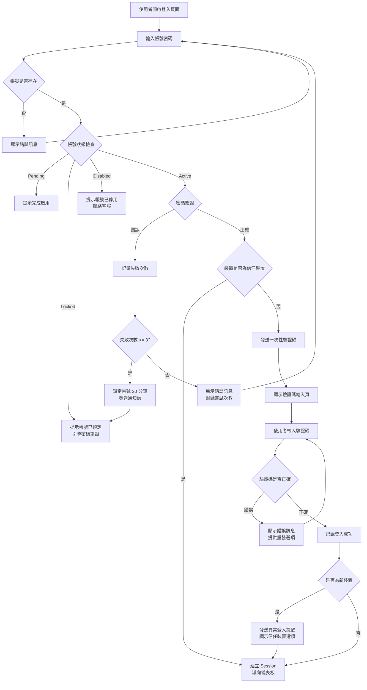
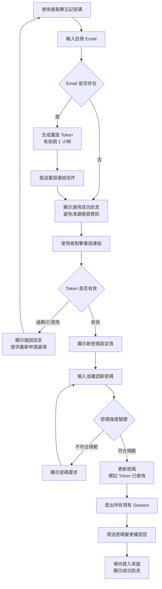
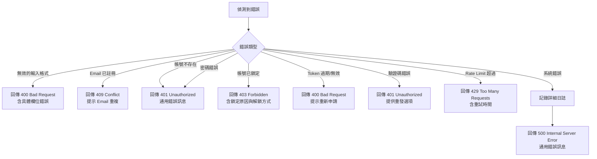

# Feature Specification Document

## Goals

完成使用者身份驗證與帳號管理功能，使合作夥伴能夠自助註冊、安全登入並維護帳號，從而降低人工開通成本、縮短導入時間，並建立可稽核的權限管理機制。

- 達成新註冊使用者首週成功登入率 ≥ 85%
- 達成啟用帳號平均處理時間 ≤ 30 分鐘
- 達成登入相關客服工單量月減少 40%
- 支援自助式註冊與安全登入的核心情境

## Background

IpLocations 目前僅提供 API 查詢服務，缺乏正式的使用者身份管理機制。合作夥伴無法自行建立帳號，需透過人工往返才能啟用服務，導致導入期延長並降低轉換率。同時，缺乏登入安全機制也產生稽核與責任歸屬風險，認證流程不友善使支援團隊耗費大量時間協助重設密碼與確認權限。

本功能將提供自助註冊、雙層防護登入、基本帳號維護流程，使商業夥伴能迅速取得授權並安全掌握資料存取，同時縮短營運團隊人工開通帳號的流程時間。此功能不包含第三方社群登入、SSO 整合或企業多層級權限管理。

## Functional Requirements

### 註冊相關需求

- **FR-001**: 系統必須提供註冊表單，包含以下必填欄位：公司名稱、聯絡人姓名、電子郵件、電話號碼 `[來源：prd.md#US-001-AC-001]`

- **FR-002**: 系統必須即時驗證表單輸入，並在使用者完成欄位填寫時提示缺漏或格式錯誤的欄位 `[來源：prd.md#US-001-AC-001]`

- **FR-003**: 系統必須在使用者成功提交註冊申請後，於 5 分鐘內寄出啟用信，並在畫面顯示後續步驟說明 `[來源：prd.md#US-001-AC-002]`

- **FR-004**: 系統必須在啟用信中包含限時啟用連結（有效期 24 小時），引導使用者完成密碼設定 `[來源：prd.md#US-001-AC-002]`

- **FR-005**: 系統必須在使用者於 24 小時內未完成啟用時，自動發送一次提醒信並將帳號標記為「待啟用」狀態 `[來源：prd.md#US-001-AC-003]`

- **FR-006**: 系統必須驗證密碼強度，要求至少 8 個字元、包含大小寫字母、數字與特殊符號其中三種 `[來源：prd.md#US-001]`

- **FR-007**: 系統必須檢查電子郵件是否已註冊，若重複則拒絕註冊並提示使用者 `[來源：prd.md#US-001]`

### 登入相關需求

- **FR-008**: 系統必須在使用者輸入正確帳號密碼後，要求輸入一次性驗證碼（OTP）方可完成登入 `[來源：prd.md#US-002-AC-001]`

- **FR-009**: 系統必須透過 Email 發送一次性驗證碼，驗證碼有效期為 10 分鐘 `[來源：prd.md#US-002-AC-001]`

- **FR-010**: 系統必須允許使用者在驗證碼過期或未收到時，點擊「重新發送」按鈕再次取得驗證碼 `[來源：prd.md#US-002-AC-001]`

- **FR-011**: 系統必須在使用者從未標記的裝置登入時，立即寄送提醒信件並顯示裝置信任確認流程 `[來源：prd.md#US-002-AC-002]`

- **FR-012**: 系統必須允許使用者將常用裝置標記為「信任裝置」，使用 HTTP-only Cookie 搭配資料庫記錄裝置指紋，標記後從該裝置登入時跳過一次性驗證碼驗證 `[來源：prd.md#US-002-AC-002]`

- **FR-013**: 系統必須記錄每次登入嘗試，包含：時間戳記、IP 位址、裝置指紋、登入結果（成功/失敗/鎖定） `[來源：prd.md#US-002]`

- **FR-014**: 系統必須在密碼連續三次輸入錯誤時，暫時鎖定帳號 30 分鐘，並引導使用者執行密碼重設流程 `[來源：prd.md#US-002-AC-003]`

- **FR-015**: 系統必須在登入成功後，導向使用者儀表板並顯示歡迎訊息與最近登入時間 `[來源：prd.md#US-002]`

### 密碼重設相關需求

- **FR-016**: 系統必須在登入頁面提供「忘記密碼」連結，引導使用者進入密碼重設流程 `[來源：prd.md#US-003]`

- **FR-017**: 系統必須在使用者提交密碼重設請求時，生成限時重設連結（有效期 1 小時）並寄送到註冊信箱 `[來源：prd.md#US-003-AC-001]`

- **FR-018**: 系統必須驗證重設連結的有效性，若連結已過期或已使用，則顯示錯誤訊息並引導重新發送 `[來源：prd.md#US-003-AC-001]`

- **FR-019**: 系統必須在使用者於重設頁面輸入新密碼時，驗證密碼強度並在符合規範後更新帳號狀態 `[來源：prd.md#US-003-AC-002]`

- **FR-020**: 系統必須在密碼重設成功後，寄送確認信件通知使用者，並自動登出所有現有 Session `[來源：prd.md#US-003]`

### 帳號狀態管理需求

- **FR-021**: 系統必須維護帳號狀態，包含：待啟用（Pending）、已啟用（Active）、已鎖定（Locked）、已停用（Disabled） `[來源：prd.md#US-001, US-002]`

- **FR-022**: 系統必須在營運後台提供帳號列表，顯示狀態、註冊時間、最近登入時間、登入失敗次數 `[來源：prd.md#Impact Scope]`

- **FR-023**: 系統必須允許營運人員手動解鎖或停用帳號 `[來源：prd.md#Impact Scope]`

## Non-Functional Requirements

- **NFR-001**: 系統應使用 Argon2 或 bcrypt 加密密碼，並確保雜湊強度符合 OWASP 標準（Argon2 建議參數：memory=64MB, iterations=3, parallelism=4；bcrypt 建議 cost factor=12）

- **NFR-002**: 系統應在使用者操作（註冊、登入、密碼重設）後 5 分鐘內完成相關信件發送

- **NFR-003**: 系統應在 2 小時閒置後自動登出使用者，活躍使用者的 Session 可持續延長至最長 24 小時

- **NFR-004**: 系統應記錄所有認證相關操作日誌，包含：使用者 ID、操作類型、時間戳記、IP 位址、結果狀態

- **NFR-005**: 系統應使用 HTTPS 傳輸所有認證相關資料，並設定 HTTP-only 與 Secure 屬性保護 Cookie

- **NFR-006**: 系統應使用 Redis 實作 Rate Limiting 機制，限制同一 IP 於 15 分鐘內最多嘗試登入 10 次，並用於 Session 快取與一次性驗證碼儲存

- **NFR-007**: 系統應在 95% 的情況下於 2 秒內完成登入驗證（不含 Email 發送時間）

- **NFR-008**: 系統應支援至少 1000 名並發使用者同時登入

- **NFR-009**: 系統應定期（每 90 天）提醒使用者更新密碼

## System Flow

### 註冊流程



### 登入流程



### 密碼重設流程



### 錯誤處理流程



## BDD Scenarios

### US-001: 自助註冊帳號 `[來源：prd.md#US-001]`

- **SCN-001** `[對應：AC-001]`
```gherkin
Scenario: 使用者填寫不完整的註冊表單
  Given 使用者開啟註冊頁面
  When 使用者僅填寫「公司名稱」與「電子郵件」欄位
  And 使用者點擊「送出」按鈕
  Then 系統應顯示「聯絡人姓名」與「電話號碼」欄位的錯誤提示
  And 系統應不允許送出表單
```

- **SCN-002** `[對應：AC-001]`
```gherkin
Scenario: 使用者輸入無效的電子郵件格式
  Given 使用者開啟註冊頁面
  When 使用者在「電子郵件」欄位輸入 "invalid-email"
  And 使用者點擊「送出」按鈕
  Then 系統應顯示「請輸入有效的電子郵件地址」錯誤訊息
  And 系統應不允許送出表單
```

- **SCN-003** `[對應：AC-002]`
```gherkin
Scenario: 使用者成功提交註冊申請
  Given 使用者開啟註冊頁面
  When 使用者填寫所有必填欄位：
    | 欄位         | 值                      |
    | 公司名稱     | ABC Tech Ltd.           |
    | 聯絡人姓名   | Alex Chen               |
    | 電子郵件     | alex@abctech.com        |
    | 電話號碼     | +886-2-1234-5678        |
  And 使用者點擊「送出」按鈕
  Then 系統應顯示「註冊申請已送出,請檢查您的信箱以完成啟用」訊息
  And 系統應在 5 分鐘內發送啟用信到 "alex@abctech.com"
  And 啟用信應包含有效期 24 小時的啟用連結
```

- **SCN-004** `[對應：AC-002]`
```gherkin
Scenario: 使用者註冊時使用已存在的電子郵件
  Given 系統中已存在帳號 "alex@abctech.com"
  And 使用者開啟註冊頁面
  When 使用者填寫所有欄位並使用 "alex@abctech.com" 作為電子郵件
  And 使用者點擊「送出」按鈕
  Then 系統應顯示「此電子郵件已註冊,請使用其他信箱或嘗試登入」錯誤訊息
  And 系統應不建立新帳號
```

- **SCN-005** `[對應：AC-003]`
```gherkin
Scenario: 使用者於 24 小時內未完成啟用
  Given 使用者已於 2025-01-15 10:00 成功提交註冊申請
  And 帳號狀態為「待啟用」(Pending)
  When 系統時間到達 2025-01-16 10:00
  And 使用者尚未點擊啟用連結
  Then 系統應自動發送一次提醒信到註冊信箱
  And 帳號狀態應維持為「待啟用」(Pending)
  And 提醒信應包含新的啟用連結
```

- **SCN-006** `[對應：AC-001]`
```gherkin
Scenario: 使用者點擊過期的啟用連結
  Given 使用者已於 25 小時前提交註冊申請
  And 啟用連結已過期
  When 使用者點擊原始啟用連結
  Then 系統應顯示「此連結已過期,請重新申請啟用」錯誤訊息
  And 系統應提供「重新發送啟用信」按鈕
```

- **SCN-007** `[對應：AC-002]`
```gherkin
Scenario: 使用者設定符合規範的密碼
  Given 使用者點擊有效的啟用連結
  And 系統顯示密碼設定頁面
  When 使用者輸入密碼 "SecureP@ss123"
  And 使用者確認密碼 "SecureP@ss123"
  And 使用者點擊「完成啟用」按鈕
  Then 系統應更新帳號狀態為「已啟用」(Active)
  And 系統應發送「帳號啟用成功」確認信
  And 系統應導向登入頁面並顯示「帳號已成功啟用,請登入」訊息
```

- **SCN-008** `[對應：AC-002]`
```gherkin
Scenario: 使用者設定不符合規範的密碼
  Given 使用者點擊有效的啟用連結
  And 系統顯示密碼設定頁面
  When 使用者輸入密碼 "weak"
  And 使用者點擊「完成啟用」按鈕
  Then 系統應顯示「密碼必須至少 8 個字元,包含大小寫字母、數字與特殊符號其中三種」錯誤訊息
  And 系統應不更新帳號狀態
```

### US-002: 安全登入與提示 `[來源：prd.md#US-002]`

- **SCN-009** `[對應：AC-001]`
```gherkin
Scenario: 使用者使用正確帳號密碼登入
  Given 使用者帳號 "alex@abctech.com" 已啟用
  And 密碼為 "SecureP@ss123"
  And 使用者開啟登入頁面
  When 使用者輸入帳號 "alex@abctech.com"
  And 使用者輸入密碼 "SecureP@ss123"
  And 使用者點擊「登入」按鈕
  Then 系統應發送一次性驗證碼到 "alex@abctech.com"
  And 系統應顯示「請輸入已發送到您信箱的驗證碼」訊息
  And 系統應顯示驗證碼輸入欄位
```

- **SCN-010** `[對應：AC-001]`
```gherkin
Scenario: 使用者輸入正確的一次性驗證碼
  Given 使用者已完成帳號密碼驗證
  And 系統已發送驗證碼 "123456" 到使用者信箱
  And 驗證碼於 10 分鐘內有效
  When 使用者輸入驗證碼 "123456"
  And 使用者點擊「驗證」按鈕
  Then 系統應建立使用者 Session
  And 系統應記錄登入成功日誌,包含時間、IP 位址與裝置資訊
  And 系統應導向使用者儀表板
  And 儀表板應顯示「歡迎回來,Alex」與最近登入時間
```

- **SCN-011** `[對應：AC-001]`
```gherkin
Scenario: 使用者輸入過期的驗證碼
  Given 使用者已完成帳號密碼驗證
  And 系統已於 11 分鐘前發送驗證碼 "123456"
  When 使用者輸入驗證碼 "123456"
  And 使用者點擊「驗證」按鈕
  Then 系統應顯示「驗證碼已過期,請重新發送」錯誤訊息
  And 系統應提供「重新發送驗證碼」按鈕
```

- **SCN-012** `[對應：AC-001]`
```gherkin
Scenario: 使用者重新發送驗證碼
  Given 使用者已完成帳號密碼驗證
  And 驗證碼已過期或未收到
  When 使用者點擊「重新發送驗證碼」按鈕
  Then 系統應發送新的驗證碼到使用者信箱
  And 系統應顯示「驗證碼已重新發送,請檢查您的信箱」訊息
  And 舊驗證碼應立即失效
```

- **SCN-013** `[對應：AC-002]`
```gherkin
Scenario: 使用者從未標記的裝置登入
  Given 使用者帳號 "alex@abctech.com" 已啟用
  And 使用者從未在目前裝置登入過
  When 使用者成功完成帳號密碼與驗證碼驗證
  Then 系統應立即發送「偵測到新裝置登入」提醒信到 "alex@abctech.com"
  And 提醒信應包含登入時間、IP 位址與裝置資訊
  And 系統應顯示「是否將此裝置標記為信任裝置?」選項
  And 系統應允許使用者選擇「信任此裝置」或「略過」
```

- **SCN-014** `[對應：AC-002]`
```gherkin
Scenario: 使用者標記裝置為信任裝置
  Given 使用者從新裝置成功登入
  And 系統顯示「是否將此裝置標記為信任裝置?」選項
  When 使用者點擊「信任此裝置」按鈕
  Then 系統應儲存裝置指紋到使用者的信任裝置清單
  And 系統應顯示「此裝置已標記為信任,下次登入將跳過驗證碼驗證」訊息
  And 下次從此裝置登入時應跳過一次性驗證碼步驟
```

- **SCN-015** `[對應：AC-002]`
```gherkin
Scenario: 使用者從已信任的裝置登入
  Given 使用者帳號 "alex@abctech.com" 已啟用
  And 目前裝置已被標記為信任裝置
  When 使用者輸入正確的帳號 "alex@abctech.com" 與密碼 "SecureP@ss123"
  And 使用者點擊「登入」按鈕
  Then 系統應跳過一次性驗證碼驗證
  And 系統應直接建立使用者 Session
  And 系統應導向使用者儀表板
```

- **SCN-016** `[對應：AC-003]`
```gherkin
Scenario: 使用者連續三次輸入錯誤密碼
  Given 使用者帳號 "alex@abctech.com" 已啟用
  And 使用者開啟登入頁面
  When 使用者輸入帳號 "alex@abctech.com" 與錯誤密碼第 1 次
  And 系統顯示「帳號或密碼錯誤,剩餘 2 次嘗試」
  And 使用者再次輸入錯誤密碼第 2 次
  And 系統顯示「帳號或密碼錯誤,剩餘 1 次嘗試」
  And 使用者第 3 次輸入錯誤密碼
  Then 系統應暫時鎖定帳號 30 分鐘
  And 系統應顯示「您的帳號已被暫時鎖定,請於 30 分鐘後再試或進行密碼重設」訊息
  And 系統應發送帳號鎖定通知信到 "alex@abctech.com"
```

- **SCN-017** `[對應：AC-003]`
```gherkin
Scenario: 使用者在鎖定期間嘗試登入
  Given 使用者帳號 "alex@abctech.com" 因連續錯誤登入而被鎖定
  And 鎖定時間尚未到期
  When 使用者輸入正確的帳號與密碼
  And 使用者點擊「登入」按鈕
  Then 系統應顯示「您的帳號已被暫時鎖定,請於 XX 分鐘後再試」訊息
  And 系統應不允許登入
  And 系統應提供「重設密碼」連結
```

- **SCN-018** `[對應：AC-003]`
```gherkin
Scenario: 鎖定期滿後使用者可正常登入
  Given 使用者帳號 "alex@abctech.com" 已於 30 分鐘前被鎖定
  And 鎖定期已過
  When 使用者輸入正確的帳號 "alex@abctech.com" 與密碼 "SecureP@ss123"
  And 使用者點擊「登入」按鈕
  Then 系統應解除帳號鎖定
  And 系統應重置登入失敗計數器為 0
  And 系統應發送一次性驗證碼並繼續正常登入流程
```

### US-003: 自助密碼重設 `[來源：prd.md#US-003]`

- **SCN-019** `[對應：AC-001]`
```gherkin
Scenario: 使用者發起密碼重設請求
  Given 使用者開啟登入頁面
  When 使用者點擊「忘記密碼?」連結
  And 使用者輸入註冊信箱 "alex@abctech.com"
  And 使用者點擊「送出」按鈕
  Then 系統應顯示「若此信箱已註冊,您將收到密碼重設連結」訊息
  And 系統應生成有效期 1 小時的重設 Token
  And 系統應發送密碼重設連結信件到 "alex@abctech.com"
```

- **SCN-020** `[對應：AC-001]`
```gherkin
Scenario: 使用者使用不存在的信箱申請密碼重設
  Given 系統中不存在帳號 "nonexistent@example.com"
  And 使用者開啟密碼重設頁面
  When 使用者輸入信箱 "nonexistent@example.com"
  And 使用者點擊「送出」按鈕
  Then 系統應顯示「若此信箱已註冊,您將收到密碼重設連結」訊息
  And 系統應不發送任何信件
  And 系統應不洩漏帳號不存在的資訊
```

- **SCN-021** `[對應：AC-001]`
```gherkin
Scenario: 使用者點擊有效的密碼重設連結
  Given 使用者已於 30 分鐘前申請密碼重設
  And 重設 Token 尚未過期且未使用
  When 使用者點擊密碼重設信件中的連結
  Then 系統應驗證 Token 有效性
  And 系統應顯示新密碼設定頁面
  And 頁面應包含「新密碼」與「確認密碼」欄位
```

- **SCN-022** `[對應：AC-001]`
```gherkin
Scenario: 使用者點擊過期的密碼重設連結
  Given 使用者已於 2 小時前申請密碼重設
  And 重設 Token 已過期
  When 使用者點擊密碼重設信件中的連結
  Then 系統應顯示「此連結已過期,請重新申請密碼重設」錯誤訊息
  And 系統應提供「重新申請」按鈕
  And 系統應不允許設定新密碼
```

- **SCN-023** `[對應：AC-002]`
```gherkin
Scenario: 使用者成功重設密碼
  Given 使用者點擊有效的密碼重設連結
  And 系統顯示新密碼設定頁面
  When 使用者輸入新密碼 "NewSecureP@ss456"
  And 使用者確認密碼 "NewSecureP@ss456"
  And 密碼符合強度規範
  And 使用者點擊「重設密碼」按鈕
  Then 系統應更新使用者密碼為 "NewSecureP@ss456"
  And 系統應標記重設 Token 為已使用
  And 系統應登出所有現有 Session
  And 系統應發送「密碼已變更」確認信到使用者信箱
  And 系統應導向登入頁面並顯示「密碼已成功重設,請使用新密碼登入」訊息
```

- **SCN-024** `[對應：AC-002]`
```gherkin
Scenario: 使用者輸入不符合規範的新密碼
  Given 使用者點擊有效的密碼重設連結
  And 系統顯示新密碼設定頁面
  When 使用者輸入新密碼 "weak"
  And 使用者點擊「重設密碼」按鈕
  Then 系統應顯示「密碼必須至少 8 個字元,包含大小寫字母、數字與特殊符號其中三種」錯誤訊息
  And 系統應不更新密碼
  And 重設 Token 應保持有效
```

- **SCN-025** `[對應：AC-001]`
```gherkin
Scenario: 使用者嘗試重複使用已用過的重設連結
  Given 使用者已成功重設密碼
  And 重設 Token 已被標記為已使用
  When 使用者再次點擊相同的密碼重設連結
  Then 系統應顯示「此連結已失效,請重新申請密碼重設」錯誤訊息
  And 系統應不允許再次重設密碼
```

- **SCN-026** `[對應：AC-002]`
```gherkin
Scenario: 使用者重設密碼後舊 Session 失效
  Given 使用者目前在裝置 A 與裝置 B 皆已登入
  And 使用者從裝置 C 完成密碼重設
  When 密碼重設成功完成
  Then 裝置 A 與裝置 B 的 Session 應立即失效
  And 使用者嘗試在裝置 A 或 B 執行操作時應被要求重新登入
  And 使用者必須使用新密碼才能登入
```

## Key Entities

- **User (使用者)**: 代表註冊使用 IpLocations 服務的合作夥伴或內部人員,包含基本資訊（公司名稱、聯絡人姓名、電子郵件、電話）、帳號狀態（Pending/Active/Locked/Disabled）、密碼雜湊值、註冊時間、最近登入時間。與 LoginAttempt、TrustedDevice、PasswordResetToken 為一對多關係。

- **LoginAttempt (登入嘗試)**: 記錄每次登入操作,包含時間戳記、IP 位址、裝置指紋、登入結果（成功/失敗/鎖定）。用於稽核追蹤與異常偵測。屬於特定 User。

- **TrustedDevice (信任裝置)**: 代表使用者標記為信任的裝置,包含裝置指紋（基於 User-Agent、IP 範圍等）、標記時間、最後使用時間。用於簡化登入流程與偵測異常登入。屬於特定 User。

- **OneTimePassword (一次性驗證碼)**: 登入時產生的限時驗證碼,包含驗證碼值、產生時間、過期時間（10 分鐘）、是否已使用。屬於特定 User 與登入請求。

- **PasswordResetToken (密碼重設 Token)**: 密碼重設流程產生的限時 Token,包含 Token 值、產生時間、過期時間（1 小時）、是否已使用。屬於特定 User。

- **EmailNotification (電子郵件通知)**: 代表系統發送的各類通知信件,包含類型（啟用/提醒/異常登入/密碼變更）、收件人、發送時間、發送狀態。與 User 為多對一關係。

## Dependencies

**外部服務相依性**：
- SMTP 郵件服務：用於發送啟用信、驗證碼、提醒信、密碼重設連結與安全通知
- Redis 快取服務：用於儲存 Session、一次性驗證碼、Rate Limiting 計數器，使用現有 Redis 實例

**內部團隊相依性**：
- 前端開發團隊：需同步開發註冊、登入、密碼重設與儀表板 UI 介面
- 營運團隊：需建立後台帳號管理介面與異常監控儀表板
- 資料團隊：需設計使用者資料庫 Schema 與索引策略

**先決工作**：
- 實作密碼加密功能（建議使用 Argon2，備選 bcrypt）
- 建立 Email 發送服務與一次性驗證碼生成機制
- 設計 Session 管理策略（2 小時閒置自動登出，最長 24 小時）
- 建立 Email 模板與通知排程機制
- 設計裝置指紋識別邏輯（基於 User-Agent、IP 範圍、瀏覽器指紋）
- 配置 Redis 用於 Session、OTP 與 Rate Limiting

## Definition of Done (DoD)

- [ ] 所有功能需求（FR-001 至 FR-023）均已實作並通過驗收標準
- [ ] 所有非功能性需求（NFR-001 至 NFR-009）已達標並經過驗證
- [ ] 所有 BDD Scenarios（SCN-001 至 SCN-026）均已實作測試並通過
- [ ] 相關 API 文件已更新至 Swagger UI
- [ ] 程式碼已通過單元測試（覆蓋率 ≥ 80%）、整合測試與回歸測試
- [ ] 無重大缺陷（Severity P0-P1）或阻礙問題
- [ ] 已完成程式碼審查並獲得至少 2 位開發者批准
- [ ] 密碼加密、Session 管理、Token 生成邏輯已通過安全審查
- [ ] 前端 UI（註冊、登入、密碼重設頁面）已完成且通過 UX 審查
- [ ] 營運後台帳號管理介面已完成並可正常使用
- [ ] Email 通知模板已建立並測試所有情境（啟用、提醒、異常登入、密碼變更）
- [ ] Rate Limiting 與帳號鎖定機制已驗證有效
- [ ] 登入效能測試達標：95% 請求於 2 秒內完成,支援 1000 並發使用者
- [ ] 部署流程已驗證且可順利執行（含資料庫遷移腳本）
- [ ] 使用者操作指引已提供（含註冊、登入、密碼重設流程說明）
- [ ] 監控與告警機制已建立（異常登入偵測、高失敗率告警）
