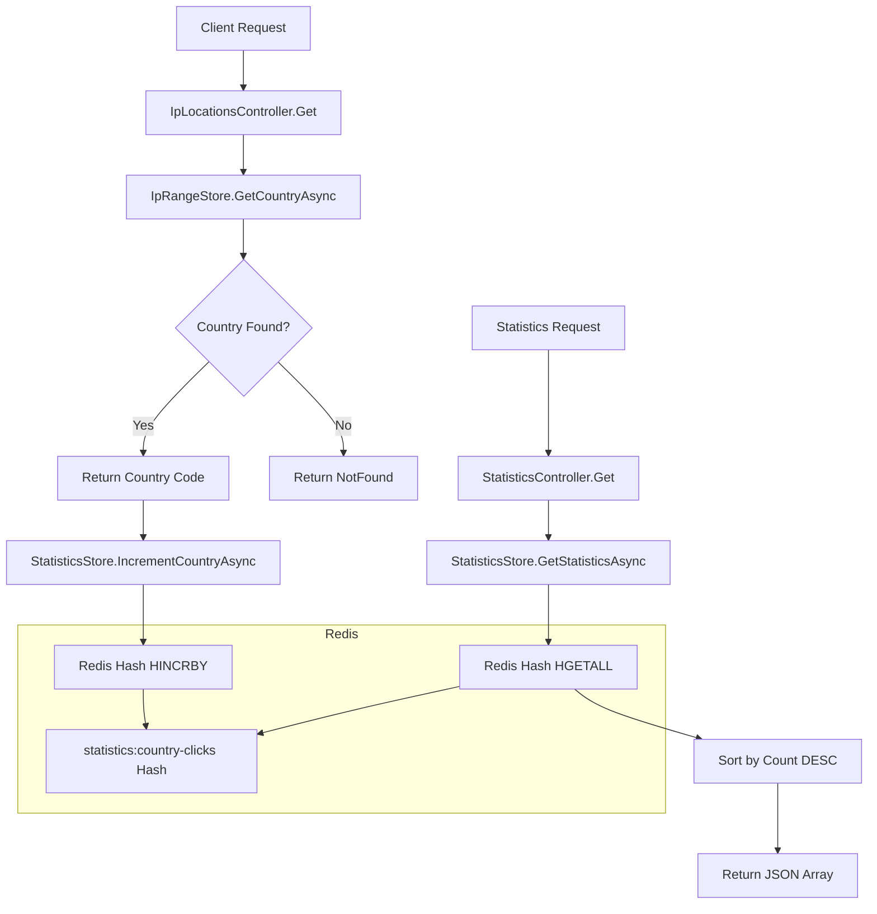

# 設計文件：API 點擊統計

## 總覽

「API 點擊統計」功能為 IpLocations API 新增統計追蹤能力。此功能將在每次成功的 IP 地區查詢後，自動記錄對應國家代碼的點擊次數，並提供一個新的 API 端點 `GET /api/statistics` 來獲取按點擊次數排序的國家統計數據。

此功能完全整合到現有的 IP 查詢流程中，不影響原有的效能要求，並利用現有的 Redis 基礎設施進行資料儲存。

## 指導文件一致性

### 技術標準 (tech.md)

本設計嚴格遵循已記載的技術模式：

- **分層架構**：新增的 `StatisticsStore` 位於 Infrastructure 層，遵循現有的 `IpRangeStore` 模式
- **相依性注入**：使用建構函式注入，在 `Program.cs` 中註冊服務
- **非同步程式設計**：所有 Redis 操作使用 `async/await` 模式
- **Redis 最佳實踐**：使用 `IConnectionMultiplexer` 單例模式，利用 `Hash` 資料結構進行高效統計操作
- **錯誤處理**：遵循現有的錯誤處理模式，服務層回傳可識別的失敗狀態

### 專案結構 (structure.md)

實作將完全遵循專案組織慣例：

- 新控制器：`src/IpLocations.Api/Controllers/StatisticsController.cs`
- 新基礎設施服務：`src/IpLocations.Api/Infra/StatisticsStore.cs`
- 擴充常數定義：在 `src/IpLocations.Api/Constants/RedisKeyConst.cs` 中新增統計相關的 Redis Key
- 測試組織：遵循現有的單元測試與整合測試結構

## 程式碼重用分析

### 可利用的現有元件

- **IConnectionMultiplexer**：直接重用現有的 Redis 連線管理
- **RedisKeyConst**：擴充此類別以定義統計功能的 Redis Key 常數
- **控制器基礎模式**：複製 `IpLocationsController` 的結構和風格
- **服務註冊模式**：遵循 `Program.cs` 中現有的服務註冊方式
- **測試基礎設施**：重用 `BaseIntegrationTest` 和 `IntegrationTestWebAppFactory`

### 整合點

- **IpLocationsController**：需要注入 `StatisticsStore` 並在成功查詢後記錄統計
- **Redis 資料庫**：統計數據與現有 IP 範圍資料共用同一個 Redis 實例
- **相依性注入容器**：在 `Program.cs` 中註冊新的 `StatisticsStore` 服務
- **測試容器**：重用現有的 Testcontainers Redis 設定

## 架構

統計功能採用事件驅動的架構，在 IP 查詢成功後異步記錄統計：



## 元件與介面

### StatisticsStore
- **目的**：管理國家代碼點擊統計的儲存與檢索
- **介面**：
  - `Task IncrementCountryAsync(string countryCode)`: 增加特定國家代碼的點擊計數
  - `Task<List<CountryStatistic>> GetStatisticsAsync()`: 獲取所有國家統計並按點擊次數降序排序
- **依賴**：`IConnectionMultiplexer` (與現有的 `IpRangeStore` 相同模式)
- **重用**：基於 `IpRangeStore` 的結構和 Redis 操作模式

### StatisticsController
- **目的**：提供統計查詢的 REST API 端點
- **介面**：
  - `GET /api/statistics`: 回傳國家代碼統計的 JSON 陣列
- **依賴**：`StatisticsStore`
- **重用**：複製 `IpLocationsController` 的結構、命名慣例和錯誤處理模式

### IpLocationsController (修改)
- **目的**：在現有功能基礎上新增統計記錄
- **修改**：注入 `StatisticsStore`，在成功查詢後調用 `IncrementCountryAsync`
- **重用**：保持現有的所有邏輯和 API 契約不變

## 資料模型

### CountryStatistic (回應模型)
```csharp
public record CountryStatistic
{
    public string CountryCode { get; init; } = string.Empty;
    public long Count { get; init; }
}
```

### Redis 資料結構
- **Key**: `statistics:country-clicks` (Hash 類型)
- **Hash Fields**: 國家代碼 (例如: "TW", "CN", "CA")
- **Hash Values**: 點擊次數 (Long 類型)
- **範例**: `{"TW": "120", "CN": "80", "CA": "100"}`

## 錯誤處理

### 錯誤情境

1. **統計記錄失敗**
   - **處理**：記錄操作採用 "fire-and-forget" 模式，失敗不影響主要 IP 查詢功能
   - **使用者影響**：使用者完全不受影響，IP 查詢照常回傳結果

2. **統計查詢時 Redis 不可用**
   - **處理**：`GetStatisticsAsync` 回傳空集合
   - **使用者影響**：API 回傳空陣列 `[]`，HTTP 200 狀態碼

3. **無效的統計資料**
   - **處理**：在 `GetStatisticsAsync` 中過濾掉無效的計數值
   - **使用者影響**：使用者只看到有效的統計資料

## 測試策略

### 單元測試
- **StatisticsStore 測試**：
  - 測試 `IncrementCountryAsync` 的 Redis HINCRBY 操作
  - 測試 `GetStatisticsAsync` 的排序邏輯
  - 測試邊界情況（空資料、無效計數）
- **StatisticsController 測試**：
  - 測試 API 回應格式
  - 測試空資料情況

### 整合測試
- **完整流程測試**：
  1. 調用 IP 查詢 API
  2. 驗證統計已被記錄
  3. 調用統計 API 驗證資料
- **多次查詢累積測試**：驗證點擊次數正確累積
- **排序功能測試**：驗證統計結果按點擊次數降序排列

### 效能測試
- **統計記錄效能**：確保統計記錄不影響 IP 查詢 API 的回應時間
- **統計查詢效能**：驗證統計 API 在大量資料下的回應時間符合 NFR-002 (200ms 內)
