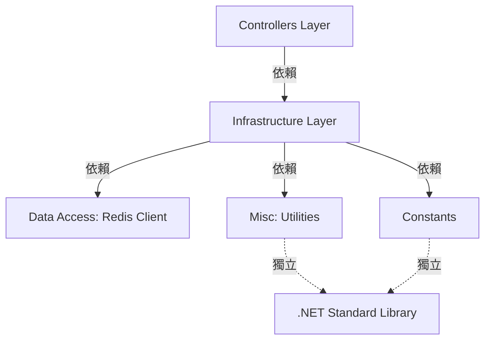

# Application Architecture

## 版本歷史

| 日期         | 版本號   | 描述             | 作者             |
| ------------ | -------- | ---------------- | ---------------- |
| 2025-10-03   | 1.0      | 初版建立         | Claude 3.5 Sonnet |

## 應用程式架構(高層次設計)

**架構風格**: 分層式單體架構 (Layered Monolithic Architecture)

**邏輯層次**:
- **Presentation Layer (呈現層)**: Controllers - 處理 HTTP 請求與回應
- **Business Logic Layer (業務邏輯層)**: Infrastructure 模組 - 封裝核心查詢邏輯
- **Data Access Layer (資料存取層)**: Redis 用戶端 (StackExchange.Redis)
- **Utilities Layer (工具層)**: Misc, Constants - 提供輔助功能

**模組互動方式**:
- 同步呼叫為主 (Redis 操作使用非同步)
- RESTful HTTP API 對外提供服務
- 依賴注入 (DI) 管理元件生命週期

**部署單元**: 
- 單一 ASP.NET Core 應用程式
- 打包為 Docker 容器映像
- 可水平擴展多個實例

**架構圖**:
```
┌─────────────────────────────────────────────────────┐
│                   Client (HTTP)                     │
└────────────────────┬────────────────────────────────┘
                     │
                     ▼
┌─────────────────────────────────────────────────────┐
│            Controllers Layer (API)                  │
│  • IpLocationsController: GET /api/IpLocations      │
└────────────────────┬────────────────────────────────┘
                     │ (Dependency Injection)
                     ▼
┌─────────────────────────────────────────────────────┐
│         Infrastructure Layer (Business Logic)       │
│  • IpRangeStore: IP 範圍查詢邏輯                     │
│  • IpConverter: IP 位址格式轉換                      │
└────────────────────┬────────────────────────────────┘
                     │
                     ▼
┌─────────────────────────────────────────────────────┐
│          Data Access Layer (Redis)                  │
│  • IConnectionMultiplexer (Singleton)               │
│  • IDatabase (Recycled Instance)                    │
└─────────────────────────────────────────────────────┘
```

## 模組邊界

**邊界模式**: 分層依賴 + 關注點分離

**模組定義與職責**:

1. **Controllers (控制器模組)**
   - **職責**: 處理 HTTP 請求、參數驗證、回應格式化
   - **公開介面**: RESTful API 端點
   - **依賴**: Infrastructure 層服務
   - **邊界**: 不應包含業務邏輯，僅作為協調層

2. **Infrastructure (基礎設施模組)**
   - **職責**: 封裝核心業務邏輯與資料存取
   - **公開介面**: `IpRangeStore` 類別
   - **依賴**: Redis 用戶端、工具模組
   - **邊界**: 對 Controllers 層隱藏 Redis 實作細節

3. **Misc (工具模組)**
   - **職責**: 提供可重用的工具函式
   - **公開介面**: `IpConverter` 靜態方法
   - **依賴**: 無外部依賴 (僅 .NET 標準函式庫)
   - **邊界**: 純函式設計，無狀態

4. **Constants (常數模組)**
   - **職責**: 集中管理應用程式常數
   - **公開介面**: `RedisKeyConst` 常數定義
   - **依賴**: 無
   - **邊界**: 僅包含常數，不可包含邏輯

**模組互動規則**:
- Controllers 可依賴 Infrastructure，但不可跨層存取 Redis
- Infrastructure 可依賴 Misc 和 Constants
- Misc 和 Constants 不可依賴其他模組 (保持獨立性)
- 所有模組透過 ASP.NET Core DI 容器管理

## 系統依賴方向

**依賴規則**: 上層依賴下層，下層不可依賴上層



**依賴注入設定**:
```csharp
// Program.cs
builder.Services.AddSingleton<IConnectionMultiplexer>(
    ConnectionMultiplexer.Connect(redisConnection));
builder.Services.AddSingleton<IpRangeStore>();
```

**依賴方向驗證**:
- Controllers → Infrastructure ✅
- Infrastructure → Redis Client ✅
- Infrastructure → Utilities ✅
- Utilities → Infrastructure ❌ (違反依賴方向)
- Constants → 任何模組 ❌ (常數層應為最底層)

## 錯誤處理與重試策略

**集中式錯誤處理**:
- ASP.NET Core 內建異常處理中介軟體
- 開發環境: 詳細錯誤頁面 (Developer Exception Page)
- 生產環境: 一般錯誤訊息 (避免洩露敏感資訊)

**錯誤分類**:

1. **可恢復錯誤 (Recoverable Errors)**:
   - Redis 暫時性連線失敗
   - 處理方式: StackExchange.Redis 內建重試機制
   - 未來考慮: 應用層指數退避重試 (Polly)

2. **用戶端錯誤 (Client Errors - 4xx)**:
   - 無效 IP 格式: 返回 400 Bad Request (未來實作)
   - IP 查詢無結果: 返回 404 Not Found
   - 速率限制超過: 返回 429 Too Many Requests (未來實作)
   - 處理方式: 直接返回錯誤，無需重試

3. **伺服器錯誤 (Server Errors - 5xx)**:
   - Redis 連線完全失敗: 返回 503 Service Unavailable
   - 未預期異常: 返回 500 Internal Server Error
   - 處理方式: 記錄錯誤日誌，返回一般錯誤訊息

**重試策略**:
```
當前實作:
- Redis Client: StackExchange.Redis 內建重試 (透過 ConfigurationOptions)
- 應用層: 無額外重試 (失敗即返回錯誤)

未來規劃:
- 實作 Polly 重試策略
- 暫時性錯誤: 指數退避重試 (3 次，間隔 1s, 2s, 4s)
- Redis 連線錯誤: Circuit Breaker 模式 (避免雪崩)
```

**日誌記錄策略**:
```csharp
// 關鍵操作日誌
logger.LogInformation("Querying IP: {IpAddress}", ip);

// 錯誤日誌 (包含堆疊追蹤)
logger.LogError(exception, "Redis query failed for IP: {IpAddress}", ip);

// 效能日誌 (可選)
logger.LogDebug("Query completed in {ElapsedMs}ms", elapsed);
```

## 組態管理

**集中式組態**:
- 使用 ASP.NET Core 組態系統 (`IConfiguration`)
- 組態來源優先順序: 
  1. 環境變數 (最高優先)
  2. User Secrets (開發環境)
  3. appsettings.{Environment}.json
  4. appsettings.json (預設值)

**環境分離**:
```
- Development: appsettings.Development.json + User Secrets
- Staging: 環境變數 (Azure App Settings / Kubernetes ConfigMap)
- Production: 環境變數 (加密後的敏感值)
```

**關鍵組態項目**:
```json
{
  "ConnectionStrings": {
    "Redis": "localhost:6379,abortConnect=false"
  },
  "Logging": {
    "LogLevel": {
      "Default": "Information",
      "Microsoft.AspNetCore": "Warning"
    }
  },
  "RateLimiting": {
    "MaxRequestsPerSecond": 10
  }
}
```

**安全性**:
- 敏感組態 (Redis 密碼、API 金鑰): 使用 Azure Key Vault 或 Kubernetes Secrets
- 開發環境: 使用 .NET User Secrets (不提交到版控)
- 連線字串: 避免硬編碼在程式碼中

**動態更新**:
- ASP.NET Core 支援組態熱重載 (appsettings.json 變更自動生效)
- Redis 連線字串變更需重啟應用程式 (ConnectionMultiplexer 為 Singleton)

## 初始化與生命週期管理

**應用程式啟動流程**:
```csharp
1. 載入組態 (appsettings.json, 環境變數)
2. 設定依賴注入容器 (AddControllers, AddSingleton<Redis>, ...)
3. 建置應用程式 (app = builder.Build())
4. 設定中介軟體管道 (Swagger, HTTPS Redirect, Authorization, ...)
5. 執行初始化邏輯 (Initialize 方法)
   - 建立 Scope
   - 呼叫 IpRangeStore.WarmUp()
   - 載入 IP 範圍資料到 Redis
6. 啟動 HTTP Server (app.Run())
```

**WarmUp 機制**:
```csharp
// 應用程式啟動時預先載入資料
private static void Initialize(IApplicationBuilder app)
{
    using var scope = app.ApplicationServices.CreateScope();
    scope.ServiceProvider.GetRequiredService<IpRangeStore>().WarmUp();
}
```

**服務生命週期**:
- `IConnectionMultiplexer`: Singleton (應用程式全域唯一實例)
- `IpRangeStore`: Singleton (無狀態，可安全重用)
- Controllers: Scoped (每個 HTTP 請求一個實例)

## 架構決策記錄 (ADR)

### ADR-001: 選擇分層式單體架構而非微服務

**狀態**: 已採納

**背景**: 
- 專案規模小，單一業務功能 (IP 查詢)
- 團隊規模小，初期無需複雜架構

**決策**: 
採用分層式單體架構，透過清晰的模組邊界確保關注點分離

**理由**:
- 簡化開發與部署流程
- 降低運維複雜度 (無需服務發現、分散式追蹤)
- 保留未來拆分為微服務的彈性 (透過明確的模組邊界)

**後果**:
- ✅ 開發速度快，易於除錯
- ✅ 部署簡單，單一容器映像
- ⚠️ 所有功能共享資源，無法獨立擴展單一功能

---

### ADR-002: 使用 Redis Sorted Set 進行 IP 範圍查詢

**狀態**: 已採納

**背景**: 
需要高效能的 IP 範圍查詢機制，支援毫秒級回應

**決策**: 
使用 Redis Sorted Set，以 IP 起始值作為 Score，支援範圍查詢

**理由**:
- `ZRANGEBYSCORE` 操作時間複雜度 O(log(N))，極快
- 記憶體內資料結構，無磁碟 I/O 延遲
- Redis 成熟穩定，社群支援良好

**替代方案**:
- PostgreSQL + B-Tree 索引: 查詢效能不足 (10-50ms)
- 記憶體內陣列 + 二分搜尋: 無持久化，重啟遺失資料

**後果**:
- ✅ 查詢效能極佳 (<5ms)
- ✅ 支援水平擴展 (Redis Cluster)
- ⚠️ 需管理 Redis 基礎設施
- ⚠️ 資料量受限於記憶體大小

---

### ADR-003: 採用 IP 範圍分區策略

**狀態**: 已採納

**背景**: 
全球 IP 範圍資料量龐大，單一 Sorted Set 可能效能下降

**決策**: 
使用 IP 數值前 3 位作為分區鍵，將資料分散到 1000 個 Sorted Set

**理由**:
- 平衡查詢效能與記憶體使用
- 避免單一 Key 過大 (Redis 單 Key 限制 512MB)
- 支援未來資料成長

**計算依據**:
```
IPv4 總數: 2^32 = 4,294,967,296
前 3 位分區: 000 ~ 999 (1000 個分區)
每分區平均: ~4,294,967 個 IP
假設 10 萬條 IP 範圍記錄，每分區約 100 條
```

**後果**:
- ✅ 查詢效能穩定
- ✅ 支援大規模資料
- ⚠️ 增加 Key 管理複雜度
- ⚠️ 需確保分區演算法一致性

---

### ADR-004: Controller 層不實作業務邏輯

**狀態**: 已採納

**背景**: 
保持 Controller 層輕量，專注於 HTTP 協調

**決策**: 
所有業務邏輯封裝在 Infrastructure 層 (IpRangeStore)

**理由**:
- 符合單一職責原則 (Single Responsibility Principle)
- 提高可測試性 (業務邏輯可獨立測試)
- 便於未來重構或抽象為介面

**後果**:
- ✅ Controller 層程式碼簡潔易讀
- ✅ 業務邏輯可重用 (如命令列工具、背景任務)
- ✅ 測試覆蓋更完整 (單元測試 + 整合測試)

---

### ADR-005: 使用 Singleton 生命週期管理 Redis 連線

**狀態**: 已採納

**背景**: 
Redis 連線建立成本高，頻繁建立會導致效能問題

**決策**: 
`IConnectionMultiplexer` 註冊為 Singleton，應用程式全域共享

**理由**:
- StackExchange.Redis 官方建議使用單例模式
- 連線池重用，避免連線耗盡
- 執行緒安全設計，支援併發存取

**後果**:
- ✅ 效能最佳化
- ✅ 資源使用最小化
- ⚠️ 組態變更需重啟應用程式
