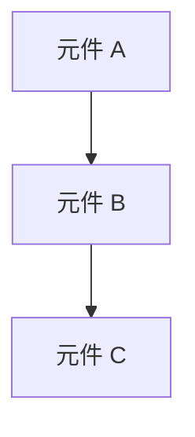

# Application Architecture

## 版本歷史

| 日期         | 版本號   | 描述             | 作者             |
| ------------ | -------- | ---------------- | ---------------- |
| [填寫日期]   | [版本號] | [5~10 字簡述]    | [AI 模型名稱]    |
| 2025-09-29   | 1.0      | 架構章節拆分建立 | GPT-5            |

## 應用程式架構(高層次設計)
```
建議模式：
- **架構風格**：單體式 / 微服務 / 事件驅動 / 分層 / 無伺服器
- **邏輯層次**：UI / Business Logic / Data  
- **模組互動方式**：同步 vs 非同步、API Gateway、Message Queue
- **部署單元**：服務 / 函式 / 套件 / 容器  
```

## 模組邊界
[定義專案不同部分如何互動並維持關注點分離]

```
邊界模式範例：
- **核心與插件**: 核心功能與可擴充插件
- **公開 API 與內部**: 公開內容與實作細節
- **平台特定與跨平台**: 作業系統特定程式碼隔離
- **穩定版與實驗性**: 生產程式碼與實驗性功能
- **依賴方向**: 哪些模組可以依賴哪些模組
```

## 系統依賴方向
[定義模組間的依賴關係，確保單向依賴並避免循環依賴]



## 錯誤處理與重試策略
[描述系統中錯誤處理的整體設計，聚焦於架構互動與邊界，非工具選型或目錄細節]

```
建議設計原則：
- **集中式錯誤處理**：在應用程式的高層捕獲並處理錯誤
- **重試機制**：對暫時性錯誤實施指數退避重試
- **錯誤分類**：區分可恢復與不可恢復錯誤
- **日誌記錄**：詳細記錄錯誤以便於調試  
```

## 組態管理
[描述系統中組態管理的整體設計，聚焦於架構互動與邊界，非工具選型或目錄細節]

```
建議設計原則：
- **集中式組態**：使用集中式服務管理組態
- **環境分離**：不同環境（開發、測試、生產）使用不同組態
- **安全性**：敏感組態（如 API 金鑰）應加密存儲
- **動態更新**：允許在不重新部署的情況下更新組態
```

## 儀表板與監控架構（如果適用）
[說明系統中「監控與儀表板」的整體設計，聚焦於架構互動與邊界，非工具選型或目錄細節]

```
建議設計原則：
- **架構模式**：可選獨立子系統（如獨立監控服務）或內嵌模組（直接於核心應用內部實作）。
- **元件協作**：Server 端負責資料收集與聚合，Client 端負責視覺化展示，Shared 元件（如 API 或事件匯流排）用於資料交換。
- **依賴關係**：監控模組應與核心應用鬆耦合，僅透過明確介面或事件通訊互動，避免直接依賴業務邏輯。
- **部署彈性**：監控s與儀表板可獨立部署、擴展或停用，不影響核心應用運作，支援動態擴充與維護。
- **安全性考量**：監控資料存取需經權限控管，避免敏感資訊外洩。
```

## 架構決策記錄 (ADR)
[記錄重要架構決策及其背後的原因]

```
建議決策範例：
1. **選擇微服務而非單體式** → 為了支援獨立部署與水平擴展  
2. **選擇事件驅動架構** → 適合高併發與鬆耦合設計  
3. **選擇 API Gateway 模式** → 集中化管理與安全控制  
```