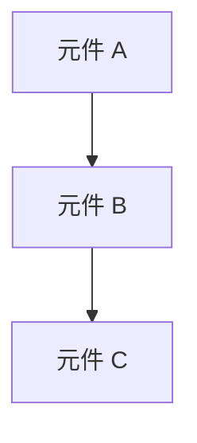

# Application Architecture

## 版本歷史
[請依下表格式記錄每次重大版本的更新資訊，每次更新請新增一行，勿覆蓋原有紀錄]

| 日期         | 版本號            | 描述          | 作者          |
| ------------ | ----------------- | ------------- | ------------- |
| [YYYY-MM-DD] | [版本號 (如 1.0)] | [5~10 字簡述] | [AI模型/姓名] |

## 應用程式架構 (高層次設計)
[以描述性段落撰寫，聚焦於系統整體設計原則與模組互動。避免提及具體技術名稱]

- **架構風格**：例如微服務架構，強調獨立部署與彈性擴展。
- **邏輯層次**：分為 UI、業務邏輯與資料層，透過 API 或事件機制互通。
- **模組互動方式**：以 API Gateway 為統一進入點，模組間以非同步事件傳遞資料。
- **安全性邊界**：所有外部請求需通過 OAuth 2.0 或 JWT 機制驗證。
- **監控與日誌**：集中式記錄與分散式分析結合，支援即時告警。
- **部署架構**：多區域部署以提升可用性與容錯能力。

## 模組邊界
[以條列方式描述模組互動規範，並補一句原則性說明]

- **核心與插件**：核心模組僅包含基礎邏輯，擴充功能以插件形式注入。
- **公開 API 與內部邏輯**：僅暴露必要端點，內部實作不可直接存取。
- **依賴方向**：高層模組依賴抽象介面，避免低層反向依賴。
- **第三方整合**：所有外部服務透過中介層統一封裝。
- **共用元件**：共用函式庫集中於 `shared` 模組，供所有子系統使用。

## 系統依賴方向
[定義模組間的依賴關係，確保單向依賴並避免循環依賴]
[**強烈建議** 使用 Mermaid 語法繪製高層次的元件依賴圖]

## 資料模型與流動 (Data Model & Flow)
[描述核心的資料實體、它們之間的關係，以及主要的資料流動路徑]
- **核心實體：** [例如：使用者 (User)、訂單 (Order)、產品 (Product)]
- **資料流動：** [例如：使用者下單 -> 訂單服務處理 -> 庫存服務更新 -> 通知服務發送郵件]

## 錯誤處理與重試策略
[描述錯誤分類與回應機制，使用表格或條列，聚焦於架構層級行為]

| 錯誤層級 | 範例               | 回應策略            | 重試規則   |
| -------- | ------------------ | ------------------- | ---------- |
| 應用層   | 驗證錯誤、輸入錯誤 | 回傳 4xx 錯誤       | 不重試     |
| 服務層   | 暫時性連線中斷     | 自動重試 (指數退避) | 最多 3 次  |
| 系統層   | 資料庫逾時         | 記錄錯誤並告警      | 管理員介入 |

## 組態管理
[描述系統組態策略與更新流程，聚焦於安全與版本化]

- **集中式組態**：使用集中式服務管理組態
- **環境分離**：不同環境（開發、測試、生產）使用不同組態
- **安全性**：敏感組態（如 API 金鑰）應加密存儲
- **動態更新**：允許在不重新部署的情況下更新組態
- **版本控制**：組態變更應納入版本控制系統

## 儀表板與監控架構 (*若功能涉及資料時納入*)
[說明系統中「監控與儀表板」的整體設計，聚焦於架構互動與邊界，非工具選型或目錄細節]

- **架構模式**：可選獨立子系統（如獨立監控服務）或內嵌模組（直接於核心應用內部實作）。
- **元件協作**：Server 端負責資料收集與聚合，Client 端負責視覺化展示，Shared 元件（如 API 或事件匯流排）用於資料交換。
- **依賴關係**：監控模組應與核心應用鬆耦合，僅透過明確介面或事件通訊互動，避免直接依賴業務邏輯。
- **部署彈性**：監控s與儀表板可獨立部署、擴展或停用，不影響核心應用運作，支援動態擴充與維護。
- **安全性考量**：監控資料存取需經權限控管，避免敏感資訊外洩。

## 架構決策記錄 (ADR)
[以條列或表格描述架構決策、理由與影響範圍]

| 決策項目         | 理由                   | 影響範圍     | 狀態   |
| ---------------- | ---------------------- | ------------ | ------ |
| 採用微服務架構   | 支援獨立部署與彈性擴展 | 所有後端模組 | 已採用 |
| 使用事件驅動設計 | 提升模組解耦與反應速度 | 訊息系統     | 進行中 |
| 建立 API Gateway | 強化安全與統一流量控制 | 外部 API     | 已完成 |