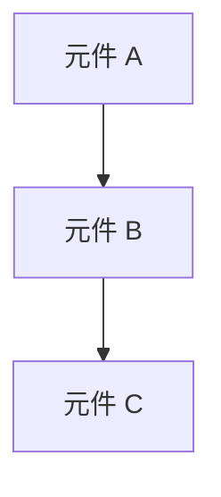
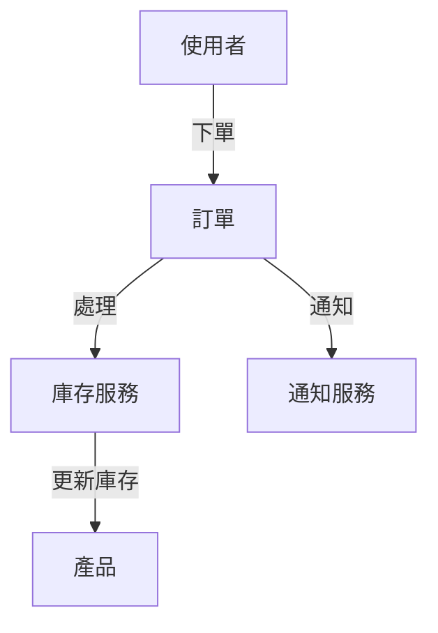

# Application Architecture

## 版本歷史
[請依下表格式記錄每次重大版本的更新資訊，每次更新請新增一行，勿覆蓋原有紀錄]

| 日期         | 版本號            | 描述          | 作者          |
| ------------ | ----------------- | ------------- | ------------- |
| [YYYY-MM-DD] | [版本號 (如 1.0)] | [5~10 字簡述] | [AI模型/姓名] |

## 應用程式架構 (高層次設計)
[以條列方式描述應用程式的整體架構設計，聚焦於架構決策與模組互動，非技術細節]

- **架構風格**：單體式 / 微服務 / 事件驅動 / 分層 / 無伺服器
- **邏輯層次**：UI / Business Logic / Data  
- **模組互動方式**：同步 / 非同步；API Gateway；Message Queue
- **安全性邊界** ：OAuth 2.0 / JWT / API Key / 內部網路
- **監控與日誌**：集中式 / 分散式、即時 / 批次
- **部署單元**：服務 / 函式 / 套件 / 容器  
- **部署架構**：單區域 / 多區域；雲端 / 本地

## 模組邊界
[以條列方式描述模組互動規範，並補一句原則性說明]

- **核心與插件**：核心模組僅包含基礎邏輯，擴充功能以插件形式注入。
- **公開 API 與內部邏輯**：僅暴露必要端點，內部實作不可直接存取。
- **依賴方向**：高層模組依賴抽象介面，避免低層反向依賴。
- **第三方整合**：所有外部服務透過中介層統一封裝。
- **共用元件**：共用函式庫集中於 `shared` 模組，供所有子系統使用。

## 系統依賴方向
[使用 Mermaid 語法繪製高層次的元件的依賴關係，確保單向依賴並避免循環依賴]

## 資料模型與流動
[請以 Data Flow Diagram (DFD) 形式繪製核心資料實體、彼此關聯及主要資料流向。條列說明資料流動脈絡，並以 Mermaid 語法輔助圖示。]

- **核心實體：** 例如：使用者 (User)、訂單 (Order)、產品 (Product)
- **資料流動：** 例如：使用者下單 → 訂單服務處理 → 庫存服務更新 → 通知服務發送郵件

## 錯誤處理與重試策略
[描述錯誤分類與回應機制，使用表格或條列，聚焦於架構層級行為]

| 錯誤層級 | 範例               | 回應策略            | 重試規則   |
| -------- | ------------------ | ------------------- | ---------- |
| 應用層   | 驗證錯誤、輸入錯誤 | 回傳 4xx 錯誤       | 不重試     |
| 服務層   | 暫時性連線中斷     | 自動重試 (指數退避) | 最多 3 次  |
| 系統層   | 資料庫逾時         | 記錄錯誤並告警      | 管理員介入 |

## 組態管理
[描述系統組態策略與更新流程，聚焦於安全與版本化]

- **集中式組態**：使用集中式服務管理組態
- **環境分離**：不同環境（開發、測試、生產）使用不同組態
- **安全性**：敏感組態（如 API 金鑰）應加密存儲
- **動態更新**：允許在不重新部署的情況下更新組態
- **版本控制**：組態變更應納入版本控制系統

## 儀表板與監控架構 (*若功能涉及資料時納入*)
[說明系統中「監控與儀表板」的整體設計，聚焦於架構互動與邊界，非工具選型或目錄細節]

- **架構模式**：可選獨立子系統（如獨立監控服務）或內嵌模組（直接於核心應用內部實作）。
- **元件協作**：Server 端負責資料收集與聚合，Client 端負責視覺化展示，Shared 元件（如 API 或事件匯流排）用於資料交換。
- **依賴關係**：監控模組應與核心應用鬆耦合，僅透過明確介面或事件通訊互動，避免直接依賴業務邏輯。
- **部署彈性**：監控與儀表板可獨立部署、擴展或停用，不影響核心應用運作，支援動態擴充與維護。
- **安全性考量**：監控資料存取需經權限控管，避免敏感資訊外洩。

## 架構決策記錄 (ADR)
[以條列或表格描述架構決策、理由與影響範圍]

### 決策記錄格式

**決策：** [決策標題]  
**日期：** [YYYY-MM-DD]  
**理由：** [為何選擇此方案]  
**替代方案：** [曾考慮但未採用的選項]  
**影響：** [此決策的主要影響範圍]  
**狀態：** [提案中 / 已採用 / 已廢棄]
