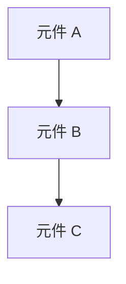
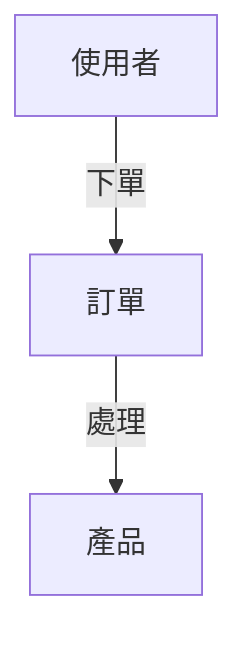

# Application Architecture

[如有待補充資訊，插入以下章節]
## 待補充資訊

- [問題 1]（章節：[章節名稱]）
- [問題 2]（章節：[章節名稱]）

## 版本歷史

| 日期       | 版本 | 變更摘要 | 作者 |
| ---------- | ---- | -------- | ---- |
| 2025-10-13 | 1.0  | 初始建立 | AI   |

## 應用程式架構 （高層次設計）
[以條列方式描述應用程式的整體架構設計，聚焦於架構決策與模組互動，非技術細節]

### 核心架構
- **架構風格**：[單體式 / 微服務 / 事件驅動 / 分層 / 無伺服器]
- **邏輯層次**：[UI / Business Logic / Data]
- **模組互動方式**：[同步 / 非同步；API Gateway；Message Queue]

### 橫切關注點
- **安全性邊界** ：[OAuth 2.0 / JWT / API Key / 內部網路]
- **監控與日誌**：[集中式 / 分散式、即時 / 批次]

### 部署架構
- **部署單元**：[服務 / 函式 / 套件 / 容器]  
- **部署架構**：[單區域 / 多區域；雲端 / 本地]

## 模組邊界
[以條列方式描述模組互動規範，並補一句原則性說明]

- **核心與插件**： [核心模組與擴充功能的關係]
- **公開 API 與內部邏輯**： [暴露介面與內部實作的分離]
- **依賴方向**： [高層與低層的依賴關係]
- **第三方整合**： [外部服務的封裝方式]
- **共用元件**： [共用函式庫的組織方式]

## 系統依賴方向
[使用 Mermaid 繪製高層次元件的依賴關係]

## 資料模型與流動
[以 Data Flow Diagram （DFD） 形式繪製核心資料實體、彼此關聯及主要資料流向]

- **核心實體：** [例如：使用者 （User）、訂單 （Order）、產品 （Product）]
- **資料流動：** [例如：使用者下單 → 訂單服務處理 → 庫存服務更新 → 通知服務發送]

## 錯誤處理與重試策略
[描述錯誤分類與回應機制，使用表格或條列，聚焦於架構層級行為]

| 錯誤層級 | 範例       | 回應策略 | 重試規則 |
| -------- | ---------- | -------- | -------- |
| [層級]   | [錯誤類型] | [策略]   | [規則]   |

## 組態管理
[描述系統組態策略與更新流程，聚焦於安全與版本化]

- **集中式組態**：[使用集中式服務管理組態]
- **環境分離**：[不同環境（開發、測試、生產）使用不同組態]
- **安全性**：[敏感組態（如 API 金鑰）應加密存儲]
- **動態更新**：[允許在不重新部署的情況下更新組態]
- **版本控制**：[組態變更應納入版本控制系統]

## 儀表板與監控架構 （*如適用*）
[說明系統中「監控與儀表板」的整體設計，聚焦於架構互動與邊界，非工具選型或目錄細節]

- **架構模式**：[可選獨立子系統（如獨立監控服務）或內嵌模組（直接於核心應用內部實作）]
- **元件協作**：[Server 端負責資料收集與聚合，Client 端負責視覺化展示，Shared 元件（如 API 或事件匯流排）用於資料交換]
- **依賴關係**：[監控模組應與核心應用鬆耦合，僅透過明確介面或事件通訊互動，避免直接依賴業務邏輯]
- **部署彈性**：[監控與儀表板可獨立部署、擴展或停用，不影響核心應用運作，支援動態擴充與維護]
- **安全性考量**：[監控資料存取需經權限控管，避免敏感資訊外洩]