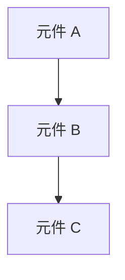

# Design Template

## Guidelines

本模板用於撰寫清晰且可執行的設計文件，指導開發團隊理解系統設計與架構。

**核心要求**：
- 基於 `research.md` 結果進行設計
- 遵循 `architecture.md` 標準，確保設計符合整體架構模式
- 遵循 `tech.md` 標準，確保設計符合文件化的技術指南
- 尊重 `structure.md` 慣例，根據專案結構組織元件
- 以現有模式為基礎，而非建立新模式

## Process Flow

### 1. 載入指導文件與需求來源

**依序讀取以下文件**：

**(1-3) 專案層級標準**
- `doc/steering/architecture.md` → 整體架構模式、設計原則
- `doc/steering/tech.md` → 技術模式、標準與最佳實踐
- `doc/steering/structure.md` → 檔案組織慣例、命名規範

**(4) 功能層級來源**
- `doc/changes/{feature-name}/spec.md` → User Story、成功指標、功能需求
  - ⚠️ 必須載入完整內容，不可遺漏任何設計細節

### 2. 研究分析

**目的**：針對整體需求進行設計推論與決策

**分析步驟：**

a. **現有架構分析：**
   - 分析需求涉及的資料模型、API、元件結構,標註對應現有實作
   - 依據 `architecture.md` 與 `tech.md`，確保設計選擇符合專案標準
   - 指出新功能如何與現有系統整合

b. **可重複使用資源盤點：**
   - 檢查程式庫中是否已有驗證、輔助函式、中介軟體、hooks 等可直接沿用
   - 主動尋找程式庫內已存在的類似功能，並註明可參考或擴展之處
   - 明確列出需新建的部分，以及可直接重複使用或擴展的現有元件

c. **評估引入新技術：** (若需要)
   - 使用 context7 取得最佳實踐與整合建議
   - 評估新技術與現有架構的相容性與整合難易度
   - 分析引入新技術的風險、效益及對專案的長期影響

**輸出格式：**
將以上研究結果整合至 `research.md`，採用以下結構：
- **決策**：[選擇了什麼]
- **理由**：[為何選擇]
- **替代方案**：[評估過的其他方案]

### 3. 生成文件草稿

**先決條件：** `research.md` 已完成

**規劃填寫策略：**
基於 `research.md` 的設計決策，逐章節填寫完整設計文件

### 4. 草稿反思與精煉

**審視內容品質：**
從使用者視角重新審視整份內容，檢查並修正：
a. 需求覆蓋 - 所有需求都有對應設計，每個 User Story 與 AC 都能映射到具體元件、API 或資料模型
b. 技術一致 - 文件內部無前後矛盾，元件命名、介面定義、架構描述在各章節保持一致 
c. 內容精煉 - 無重複或冗餘內容，避免多處重複描述相同元件或設計決策
d. 決策有據 - 設計決策有清晰依據，技術選擇源自 research.md 分析並符合專案標準

若發現問題 → 直接修正 → 繼續後續步驟

### 5. Contracts

a.  **從功能需求中產生 API 合約**：
    - 對於每個使用者動作 → 端點
    - 使用標準 REST/GraphQL 模式
    - 將 OpenAPI/GraphQL 結構描述輸出到 `/contracts/`

## Template

以下為最終需求文件的 Markdown 範本：

```markdown
## Feature Design Document

## Summary

[功能及其在整個系統中位置的高層級描述]

## Code Reuse Analysis

### 可利用的現有元件
- **[元件/公用程式名稱]**: [將如何使用]
- **[服務/協助程式名稱]**: [將如何擴充]

### 整合點
- **[現有系統/API]**: [新功能將如何整合]
- **[資料庫/儲存]**: [資料將如何連接到現有結構]

## File Structure

[以樹狀結構呈現新增或修改的目錄結構]

```
src/
├── [層次目錄]/
│   └── [檔案名稱]                     # 簡短用途說明
├── [層次目錄]/
│   ├── [子目錄]/
│   │   ├── [檔案名稱]                 # 簡短用途說明
│   │   └── [檔案名稱]                 # 簡短用途說明
│   └── [子目錄]/
│       ├── [檔案名稱]                 # 簡短用途說明
│       └── [檔案名稱]                 # 簡短用途說明
```

## Architecture

[描述所使用的整體架構和設計模式]



## Components and Interfaces

### Component 1
- **目的:** [此元件的功能]
- **介面:** [公開方法/API]
- **依賴:** [其依賴的項目]
- **重用:** [其基於的現有元件/公用程式]

### Component 2
- **目的:** [此元件的功能]
- **介面:** [公開方法/API]
- **依賴:** [其依賴的項目]
- **重用:** [其基於的現有元件/公用程式]

## Data Models

### Model 1

[以您的語言定義 Model1 的結構]

- id: [唯一識別碼類型]
- name: [字串/文字類型]
- [視需要其他屬性]

### Model 2

[以您的語言定義 Model2 的結構]

- id: [唯一識別碼類型]
- [視需要其他屬性]

## Error Handling

### 錯誤情境
1. **情境 1:** [描述]
   - **處理:** [如何處理]
   - **使用者影響:** [使用者看到的內容]

2. **情境 2:** [描述]
   - **處理:** [如何處理]
   - **使用者影響:** [使用者看到的內容]

## Testing Strategy

### Unit Testing
- [單元測試方法]
- [要測試的關鍵元件]

### Integration Testing
- [整合測試方法]
- [要測試的關鍵流程]

### End-to-End Testing
- [E2E 測試方法]
- [要測試的使用者情境]
```