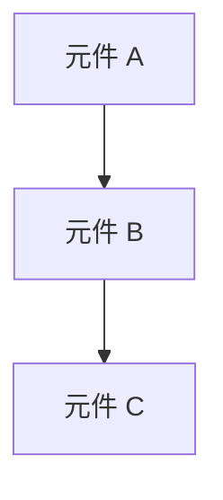

# Design Template

## Guidelines

本模板用於撰寫清晰且可執行的設計文件，指導開發團隊理解系統設計與架構。

**核心要求**：
- 描述**高階架構設計**與**技術決策依據**，而非**程式碼實作細節**
- 基於 `research.md` 結果進行設計
- 遵循指導文件（`architecture.md`、`tech.md`、`structure.md`）定義的標準
- 記錄對指導文件的**調整**與**新增設計**，維持不變的無需說明

**重要提醒**：
- ⚠️ 這是設計文件，不是程式碼文件
- ⚠️ 描述元件職責與介面，而非實作細節
- ⚠️ 使用文字、圖表、結構說明，避免程式碼範例

## Process Flow

### 1. 載入指導文件與需求來源

**依序讀取以下文件**：

**指導文件（專案標準）**：
- `doc/steering/architecture.md` → 整體架構模式、設計原則
- `doc/steering/tech.md` → 技術模式、標準與最佳實踐
- `doc/steering/structure.md` → 檔案組織慣例、命名規範

**需求來源（功能需求）**：
- `doc/changes/{feature-name}/spec.md` → User Story、成功指標、功能需求
   - ⚠️ 必須載入完整內容，不可遺漏任何設計細節

### 2. 研究分析

**目的**：針對整體需求進行設計推論與決策

**分析步驟：**

a. **現有架構分析：**
   - 分析需求涉及的資料模型、API、元件結構,標註對應現有實作
   - 依據 `architecture.md` 與 `tech.md`，確保設計選擇符合專案標準
   - 指出新功能如何與現有系統整合

b. **可重複使用資源盤點：**
   - 檢查程式庫中是否已有驗證、輔助函式、中介軟體、hooks 等可直接沿用
   - 主動尋找程式庫內已存在的類似功能，並註明可參考或擴展之處
   - 明確列出需新建的部分，以及可直接重複使用或擴展的現有元件

c. **評估引入新技術：** (若需要)
   - 使用 context7 取得最佳實踐與整合建議
   - 評估新技術與現有架構的相容性與整合難易度
   - 分析引入新技術的風險、效益及對專案的長期影響

d. **識別與過濾**：
   - 在前述分析中，識別「維持不變」、「調整擴展」、「全新設計」
   - **只將「調整」與「新增」的決策寫入 research.md**（「維持不變」不記錄）
   - 確保每個決策都有充分的理由、影響分析、替代方案評估

**輸出格式：**
將研究結果整合至 `research.md`，每個決策包含：
- **決策**：[選擇了什麼]
- **理由**：[為何選擇]
- **替代方案**：[評估過的其他方案]

**完成後檢查：**
- 需求覆蓋是否完整？
- 技術選擇是否符合專案標準？
- research.md 是否只記錄「調整」與「新增」？（「維持不變」未記錄）
- 每個決策的理由、影響、替代方案是否完整？

若有重大問題 → 直接修正 → 繼續後續步驟

### 3. 生成文件草稿

**先決條件：** `research.md` 已完成

**執行前準備**：
根據 `research.md` 的分析結果，先完成以下整理：
- 提取所有設計決策及其對應的系統元件
- 識別涉及的資料模型、服務、API 端點
- 確認哪些章節需要詳細描述，哪些可簡化

**規劃填寫策略**：
依照 Template 結構，逐章節填寫設計文件：
- **判斷章節內容深度**：該章節是否有 research.md 對應的決策分析？
  - 若有 → 引用決策結論並描述設計結構
  - 若無 → 簡化該章節（一句話或引用指導文件）
- **確保一致性**：元件命名、介面定義在各章節保持一致
- **補充視覺化**：為關鍵元件添加架構圖（Mermaid）與依賴關係說明

### 4. 草稿反思與精煉

**審視內容品質：**
從使用者視角重新審視整份內容，檢查並修正：

a. 需求覆蓋 - 所有需求都有對應設計，每個 User Story 與 AC 都能映射到具體元件、API 或資料模型
b. 技術一致 - 文件內部無前後矛盾，元件命名、介面定義、架構描述在各章節保持一致 
c. 內容精煉 - 無重複或冗餘內容，避免多處重複描述相同元件或設計決策
d. 抽象層次 - 以架構圖、介面定義、資料結構為主，移除完整的函式實作或逐行程式碼

若發現問題 → 直接修正 → 繼續後續步驟

### 5. Contracts（若功能涉及 API 設計）

**從功能需求中產生 API 合約**：
- 對於每個使用者動作 → 端點
- 使用標準 REST/GraphQL 模式
- 將 OpenAPI/GraphQL 結構描述輸出到 `/contracts/`

## Template

以下為設計文件的 Markdown 範本：

```markdown
## Feature Design Document

## Summary

[功能及其在整個系統中位置的高層級描述]

## Code Reuse Analysis

### 可利用的現有元件
- **[元件/公用程式名稱]**: [將如何使用]
- **[服務/協助程式名稱]**: [將如何擴充]

### 整合點
- **[現有系統/API]**: [新功能將如何整合]
- **[資料庫/儲存]**: [資料將如何連接到現有結構]

## File Structure

[以樹狀結構呈現新增或修改的目錄結構]

```
src/
├── [層次目錄]/
│   └── [檔案名稱]                     # 簡短用途說明
├── [層次目錄]/
│   ├── [子目錄]/
│   │   ├── [檔案名稱]                 # 簡短用途說明
│   │   └── [檔案名稱]                 # 簡短用途說明
│   └── [子目錄]/
│       ├── [檔案名稱]                 # 簡短用途說明
│       └── [檔案名稱]                 # 簡短用途說明
```

## Architecture

*若無架構層面的調整或新設計，可簡化為：「遵循專案標準架構（詳見 architecture.md）」*

[描述架構調整或新設計]



## Components and Interfaces

### Component 1
- **目的:** [此元件的功能]
- **介面:** [公開方法/API]
- **依賴:** [其依賴的項目]
- **整合/擴展:** [若有重用或擴展既有元件，說明方式與影響]

### Component 2
- **目的:** [此元件的功能]
- **介面:** [公開方法/API]
- **依賴:** [其依賴的項目]
- **整合/擴展:** [若有重用或擴展既有元件，說明方式與影響]

## Data Models

### Model 1

[以您的語言定義 Model1 的結構]

- id: [唯一識別碼類型]
- name: [字串/文字類型]
- [視需要其他屬性]

### Model 2

[以您的語言定義 Model2 的結構]

- id: [唯一識別碼類型]
- [視需要其他屬性]

## Error Handling

### 錯誤情境
1. **情境 1:** [描述]
   - **處理:** [如何處理]
   - **使用者影響:** [使用者看到的內容]

2. **情境 2:** [描述]
   - **處理:** [如何處理]
   - **使用者影響:** [使用者看到的內容]

## Testing Strategy

*列出測試目標與覆蓋範圍，對應 spec.md 的 Scenarios*

### Unit Testing
- [測試目標]

### Integration Testing
- [測試目標] (對應 SCN-XXX)

### End-to-End Testing
- [測試目標]

*若有超出標準測試方法的特殊策略，在此說明*
```