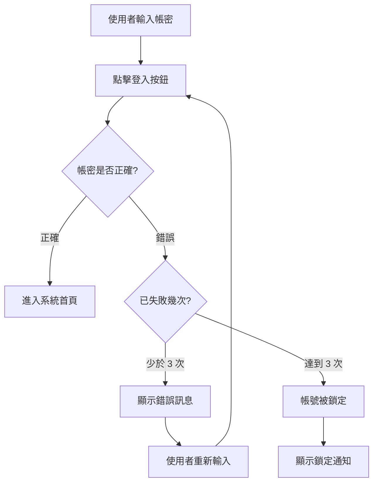

# Product Requirement Document (PRD) Template


## Guidelines

本模板用於撰寫清晰且可執行的產品需求文件，指導開發團隊理解並實現所需功能。

**核心要求**
- 清晰定義使用者**需要什麼 (What)** 以及**為什麼需要 (Why)**
- 描述功能如何滿足使用者需求，而非討論技術實作
- 為業務利害關係人撰寫，使用業務語言而非技術術語
- 明確定義使用者價值、商業成果與需求範圍
  
**禁止內容：**
- ❌ 技術實作細節：演算法名稱(如 BCrypt、AES)、框架(如 JWT、OAuth2)、程式語言、資料庫
- ❌ 系統架構：類別名稱、檔案路徑、API 端點實作、中介軟體
- ❌ 技術決策：為何選擇某技術方案、技術比較、效能調校

### 優先級定義 (P1/P2/P3)**

| 優先級 | 定義 | 判斷標準 |
|--------|------|----------|
| **P1** | 核心功能 | 缺失則產品無法運作、使用者無法完成主要任務、法規或安全必須項目 |
| **P2** | 重要功能 | 顯著提升使用者體驗、多數使用者會使用、競品標配功能 |
| **P3** | 增值功能 | 優化特定情境、少數使用者需求、Nice to have |

### [NEEDS CLARIFICATION] 標記原則

**核心判斷標準：**
「當產品經理、設計師或開發者看到這段需求時，是否可能產生不同的合理解讀？」

**思考框架：**

1. **量化數值**是否明確？
   - ✅ 有具體數字（「2秒內」「100MB」） → 無需標記
   - ❌ 模糊描述（「快速」「大型檔案」） → 需要標記

2. **業務選擇**是否唯一？
   - ✅ 業界標準做法或可從上下文推論 → 無需標記
   - ❌ 存在多種合理選擇且影響使用者體驗 → 需要標記

3. **法規政策**是否涉及？
   - ✅ 標準安全要求（密碼加密、HTTPS） → 無需標記
   - ❌ 涉及資料保留、隱私、第三方分享 → 需要標記

**反例：過度標記的情況**
❌ 檔案上傳需顯示進度 [NEEDS CLARIFICATION: 未說明顯示方式]
→ 錯誤：「顯示進度」本身是業務需求（應包含在 PRD），進度條是標準做法無需標記。具體 UI 樣式屬設計範疇。

❌ 搜尋結果應依相關性排序 [NEEDS CLARIFICATION: 演算法未定義]
→ 錯誤：應標記但原因錯誤。正確做法是標記「相關性的業務定義不明確（按標題符合度？銷量？時間？）」，而非「演算法」（演算法屬技術實作）。

**正例：應該標記的情況**
✅ 使用者上傳大型檔案時應有限制 [NEEDS CLARIFICATION: 「大型」未量化 - 10MB？100MB？1GB？]
→ 正確：不同產品的檔案大小限制差異極大，影響儲存成本與使用者體驗

✅ 系統應保留使用者歷史紀錄 [NEEDS CLARIFICATION: 保留期限未定義 - 30天？1年？永久？]
→ 正確：資料保留政策涉及法規遵循、隱私權與儲存成本，需明確業務決策

### EARS 格式規範
所有驗收標準必須採用以下五種 EARS 模式之一：

1. **普遍性**： `[系統] 應 [動作]`
2. **事件驅動**： `當 [事件] 發生時，則 [系統] 應 [回應]`
3. **狀態驅動**： `在 [狀態] 期間，[系統] 應 [行為]`
4. **非預期行為**： `如果 [異常] 發生，則 [系統] 應 [處理]`
5. **可選功能**： `在 [條件] 下，[系統] 應能夠 [行為]`

**撰寫原則**：
- 每條標準必須可測試（能明確判定通過/失敗）
- 使用具體數值而非模糊詞彙（「2秒內」而非「快速」）
- 優先使用事件驅動與非預期行為格式描述互動與錯誤處理

**描述範圍**：
- AC 應描述使用者可觀察的系統行為與業務規則，但不描述技術實作

範例對照：
- ✅ 可測試：「系統應拒絕少於 8 字元的密碼」
- ❌ 過於模糊：「系統應驗證密碼強度」
- ✅ 業務規則：「當密碼錯誤 3 次時，則系統應鎖定帳號 30 分鐘」
- ❌ 技術實作：「系統應使用 BCrypt 加密密碼」

## Process Flow

### 1. 載入指導文件與需求分析

**依序讀取並提取關鍵資訊：**

a. **產品脈絡**
   - 讀取 `doc/steering/product.md`
   - 提取:產品目的、核心功能、目標使用者

b. **需求分析**
   - 基於 `<feature-name>` 與 `<description>` 仔細業務分析
   - 識別使用者情境、評估優先度、判斷流程複雜度
   - 所有引用資訊標記來源 `[來源:文件名稱#章節或標題]`

### 2. 生成文件草稿

**執行前準備**：
根據載入的文件內容與需求分析結果，先完成以下整理：
- 將整個功能需求拆解成一系列獨立、完整且對使用者有價值的 User Stories
- 每個 User Story 應代表一個具體的業務需求或使用者場景
- 根據優先級定義（P1/P2/P3）判斷每個 Story 的優先順序
- 識別哪些需求已有明確資訊，哪些需要標記釐清

**規劃填寫策略**：
依照 Guidelines 中的各項規範，逐章節填寫 template：
- 已有明確設計決策的部分 → 直接填寫
- 需要具體細節但無法推斷的部分 → 標記 `[NEEDS CLARIFICATION: 具體問題]`
- 為每個 User Story 撰寫符合 EARS 格式的 Acceptance Criteria

### 3. 調研與補充資訊

**對草稿中所有標記為 `[NEEDS CLARIFICATION]` 的項目，進行調研：**

- 對於每個「需要釐清」的項目 → 搜尋業界標準與最佳實務
- 對於每個「使用者情境」→ 搜尋同類產品的使用案例
- 對於每個「量化指標」→ 搜尋業界基準值

**調研結果處理**（依調研結果決定）：
- 若找到明確答案 → 直接補充，移除 `[NEEDS CLARIFICATION]` 標記
- 若找到合理假設 → 補充並註記 `[基於假設：XXX]`
- 若完全無法推斷 → 保留 `[NEEDS CLARIFICATION]`，並準備建議選項

### 4. 草稿反思與精煉

**審視內容品質：**
從開發團隊視角重新審視整份內容，檢查並修正：
a. 邏輯完整性 - Problem → Solution → User Stories → Success Metrics，因果鏈清晰
b. 表達一致性 - 術語定義在各章節使用一致，優先級判斷符合標準
c. 開發導向性 - 描述系統行為而非技術實作，AC 可測試但不含演算法/框架/API

若發現問題 → 直接修正 → 繼續後續步驟

### 5. 最終檢查與整理

**檢查剩餘標記**：
- 確認所有保留的 `[NEEDS CLARIFICATION]` 標記確實無法透過調研解決
- 確認每個標記都有準備建議選項

**整理待補充資訊**：
- **若仍有 `[NEEDS CLARIFICATION]` 標記** → 於文件指定佔位符新增「## 待補充資訊」章節
- 條列所有需澄清問題，並附上基於調研的建議選項供使用者參考

## Template

以下為最終需求文件的 Markdown 範本：

```markdown
# Product Requirements Document (PRD)

[如有需澄清資訊，插入以下章節]
## 待補充資訊

- [問題 1]（章節：[章節名稱]）
   - 建議：[選項 A / 選項 B / 選項 C]
- [問題 2]（章節：[章節名稱]）
   - 建議：[選項 A / 選項 B]

## Glossary
[列出需求特有的業務術語及其定義，使用業務語言。避免技術實作術語如演算法名稱、框架、程式語言等]

- **[中文術語] (English Term)**：[從使用者角度的簡明定義]
- **[中文術語] (English Term)**：[從使用者角度的簡明定義]

## Executive Summary
[從業務角度描述背景、需解決的問題、核心目標與預期功能。專注於使用者價值與業務成果，避免技術實作細節]

## Problem Statement
[清晰且有證據地闡述問題。解決：現狀與痛點、問題的影響（如果可能，請量化）、為何現有解決方案不足與現在解決此問題的緊迫性和重要性]

## Proposed Solution
[從業務角度描述解決方案。專注於使用者體驗、功能流程、業務規則。避免提及具體技術選型如演算法、框架、協定名稱等]


## User Scenario

### Personas

| 角色 | 描述 | 主要目標 |
|------|------|----------|
|  [角色名稱] |  [角色的工作或使用背景] |  [想達成的目標] |


### Scenario Description
[以敘述性文字描述真實使用場景，說明使用者在什麼情況下、為何需要此功能、希望達到的結果]

### User Flow *(若功能是否涉及多步驟操作或決策分支則包含)*



## User Stories

### US-001 - [簡要標題] (Priority: P1)

[以簡單語言描述此用戶旅程]

**為何此優先級**：[解釋其價值以及為何具有此優先級]

**獨立測試**：[描述如何獨立測試]

**Acceptance Criteria**：
[條列式驗收標準，採用 EARS 格式。專注於使用者可觀察的系統行為，避免描述內部實作細節]

- **AC-001**：[EARS 格式 - 描述使用者可見的行為與結果] ([模式])
- **AC-002**：[EARS 格式 - 描述使用者可見的行為與結果] ([模式])

### US-002 - [簡要標題] (Priority: P2)

[以簡單語言描述此用戶旅程]

**為何此優先級**：[解釋其價值以及為何具有此優先級]

**獨立測試**：[描述如何獨立測試]

**Acceptance Criteria**：
[條列式驗收標準，採用 EARS 格式。專注於使用者可觀察的系統行為，避免描述內部實作細節]

- **AC-001**：[EARS 格式 - 描述使用者可見的行為與結果] ([模式])

### US-003 - [簡要標題] (Priority: P3)

[以簡單語言描述此用戶旅程]

**為何此優先級**：[解釋其價值以及為何具有此優先級]

**獨立測試**：[描述如何獨立測試]

**Acceptance Criteria**：
[條列式驗收標準，採用 EARS 格式。專注於使用者可觀察的系統行為，避免描述內部實作細節]

- **AC-001**：[EARS 格式 - 描述使用者可見的行為與結果] ([模式])

## Impact Scope
[從業務角度列出受影響的現有功能或流程，禁止提及技術實作細節如程式碼檔案、類別、資料庫等]

- [受影響的業務功能或使用者流程 1]:[從使用者角度說明如何受影響]
- [受影響的業務功能或使用者流程 2]:[從使用者角度說明如何受影響]

## Success Metrics

- [KPI 1]：使用者成功率 > XX%  
- [KPI 2]：平均任務完成時間 < XX 秒  
- [KPI 3]：上線後 N 週內使用率提升 XX%  

## Out of Scope
[明確列出不在本次範圍內的事項，防止需求蔓延]

```