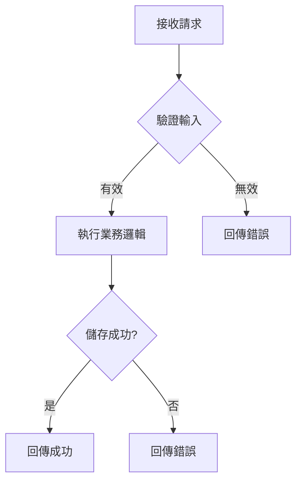
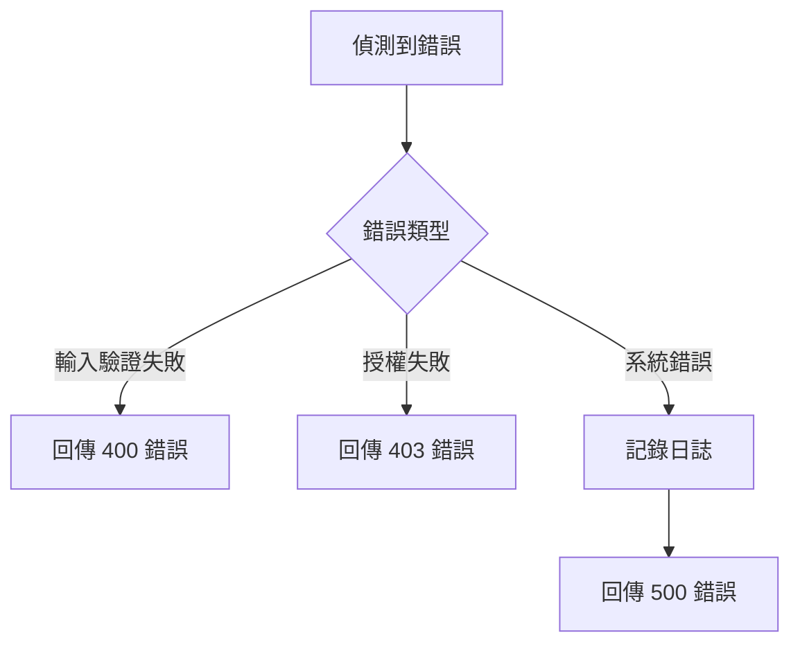

# Specification Template

## Guidelines

本模板用於撰寫清晰且可執行的功能規格文件，指導開發團隊理解系統需求與行為。

**核心要求**：
- 定義系統**如何做 (How)** 以及**做到什麼品質 (How Well)**
- 描述系統邏輯、資料設計、行為規則與邊界條件
- 使用開發團隊能理解的語言，但**禁止指定實作技術**（API、框架、程式碼）
- 每個需求必須獨立、可測試、可驗證

### Feature Scenarios 格式規範

採用 Gherkin 語法：

```gherkin
Scenario: [場景描述]
  Given [前置條件]
  When [觸發動作]
  Then [預期結果]
```

**撰寫原則**：
- 每個 Scenario 僅對應一個 AC，標註 `[對應：AC-XXX]`
- 判斷方式：Scenario 的 **Then 驗證目標** 屬於哪個 AC，就對應該 AC
- Given 中的前置條件不影響對應關係（即使提到其他 AC）
- 每個 AC 需建立多個 Scenarios，涵蓋：正常流程、邊界情境、錯誤處理
- 使用具體數值和明確驗證點，避免模糊描述
- Given 描述前置狀態，When 描述操作，Then 描述可驗證結果

### [NEEDS CLARIFICATION] 標記原則

**核心判斷標準：**
「如果開發團隊看到這個需求時，是否有 2 種以上合理的實作方式？」

**思考框架：**
1. 這個需求的**驗收標準**是否明確？
   - ✅ 能寫出具體測試案例 → 不需標記
   - ❌ 無法確定「通過」的定義 → 需要標記

2. 這個需求是否有**業界共識**？
   - ✅ 有明確標準或慣例 → 可補充假設，不標記
   - ❌ 做法因產品而異 → 需要標記

3. 這個需求是否能從 **PRD 上下文推斷**？
   - ✅ 其他章節有線索 → 可推斷，不標記
   - ❌ 完全無法推測 → 需要標記

**反例：過度標記的情況**
❌ 系統必須驗證使用者輸入 [NEEDS CLARIFICATION: 未指定驗證規則]
→ 錯誤：應該先檢查 PRD 是否有提到，或參考業界標準

❌ 系統必須回應請求 [NEEDS CLARIFICATION: 未指定回應格式]
→ 錯誤：JSON 是 API 的業界慣例，可直接假設

**正例：應該標記的情況**
✅ 系統必須在合理時間內回應 [NEEDS CLARIFICATION: 「合理」未量化]
→ 正確：無法寫出測試案例

✅ 系統必須驗證使用者身份 [NEEDS CLARIFICATION: 驗證方式未指定 - 密碼/OTP/生物辨識？]
→ 正確：有多種合理方案，影響架構設計

## Process Flow

### 1. 載入指導文件與需求來源 

**依序讀取並提取關鍵資訊：**

a. **產品脈絡**
   - 讀取 `doc/steering/product.md`
   - 提取：產品目的、核心功能、目標使用者

b. **需求來源**
   - 讀取 `doc/changes/{feature-name}/prd.md`
   - 提取：所有 User Stories（US-XXX）與 Acceptance Criteria（AC-XXX）
   - **注意**：必須載入完整的 PRD，不可遺漏任何 US

### 2. 生成文件草稿

**規劃填寫策略：**
依照 Guidelines 中的各項規範，逐章節填寫 template
- 已有明確設計決策的部分 → 直接填寫
- 需要具體細節但無法推斷的部分 → 標記 `[NEEDS CLARIFICATION: 具體問題]`

### 3. 調研與補充資訊

**對草稿中所有標記為 `[NEEDS CLARIFICATION]` 的項目，進行調研：**

- 對於每個「需要釐清」的項目 → 搜尋業界標準與最佳實務
- 對於每個「相依性」→ 搜尋該服務/系統的文件與限制
- 對於每個「整合點」→ 搜尋常見整合模式

**調研結果處理：**
- 若找到明確答案 → 直接補充，移除 `[NEEDS CLARIFICATION]` 標記
- 若找到合理假設 → 補充並註記 `[基於假設： XXX]`
- 若完全無法推斷 → 保留 `[NEEDS CLARIFICATION]`，並準備建議選項

### 4. 草稿反思與精煉

**審視內容品質：**
從開發團隊視角重新審視整份內容，檢查並修正：
a. 邏輯完整性 - PRD 目標 → FR 定義 → Scenario 驗證，因果鏈清晰
b. 表達一致性 - 術語概念在各章節描述一致
c. 開發導向性 - 可實作但不指定技術，避免 API/框架等實作細節
d. 完整性驗證 - 每個 US 的每個 AC 都有對應的 FR 與 Scenario，若有遺漏立即補充

若發現問題 → 直接修正 → 繼續後續步驟

### 5. 最終檢查與整理

**檢查剩餘標記**
- 確認所有保留的 `[NEEDS CLARIFICATION]` 標記確實無法透過調研解決
- 確認每個標記都有準備建議選項

**整理待補充資訊**
- **若仍有 `[NEEDS CLARIFICATION]` 標記**：於文件指定佔位符新增「## 待補充資訊」章節
- 條列所有需澄清問題，並附上基於調研的建議選項供使用者參考

## Template

以下為最終需求文件的 Markdown 範本：

```markdown
# Feature Specification Document

[如有需澄清資訊，插入以下章節]
## 待補充資訊

- [問題 1]（章節：[章節名稱]）
   - 建議：[選項 A / 選項 B / 選項 C]
- [問題 2]（章節：[章節名稱]）
   - 建議：[選項 A / 選項 B]

## Goals
[一句話描述此功能成功後的結果]

- [達成 PRD 中的成功指標]
- [支援核心使用者情境]

## Background
[1-2 個簡短段落，總結背景，例如我們在 PRD 中學到的內容，避免與目標重複，這解決了什麼問題以及為什麼，目前的概況或需求是什麼]

## Functional Requirements

**標註格式：** `[來源：US-{ID}-AC-{ID}]`

- **FR-001**: 系統必須 [具體能力] `[來源：prd.md#US-XXX-AC-XXX]`
- **FR-002**: 系統必須 [具體能力] `[來源：prd.md#US-XXX-AC-XXX]`

*不明確需求標註範例：*

- **FR-006**: 系統必須透過 [NEEDS CLARIFICATION： 未指定驗證方法 - 電子郵件/密碼, SSO, OAuth?] 來驗證使用者 `[來源：prd.md#US-XXX-AC-XXX]`
- **FR-007**: 系統必須將使用者資料保留 [NEEDS CLARIFICATION： 未指定保留期限] `[來源：prd.md#US-XXX-AC-XXX]`

## Non-Functional Requirements
- **NFR-001**: 系統應在 [NEEDS CLARIFICATION： 未指定負載量] 的同時支援至少 [NEEDS CLARIFICATION： 未指定使用者數量] 名使用者
- **NFR-002**: 系統應在 [NEEDS CLARIFICATION： 未指定時間] 內回應 95% 的請求
- **NFR-003**: 系統應符合 [NEEDS CLARIFICATION： 未指定標準] 的安全性標準
- **NFR-004**: 系統應具備 [NEEDS CLARIFICATION： 未指定備援需求] 的高可用性

## System Flow *(若功能涉及多步驟流程或狀態轉換則包含)*

### 主流程


### 錯誤處理流程 *(若有複雜錯誤處理邏輯則包含)*


## Feature Scenarios

[針對 PRD 中的每個 User Story，依序為其**每個 AC** 撰寫對應的 Feature Scenarios]

### US-001 - [簡要標題] (Priority: P1)

[為此 User Story 建立多個 Scenario，涵蓋正常流程、邊界情境、錯誤處理]

- **SCN-001** `[對應：AC-XXX]`
```gherkin
[使用 gherkin 程式碼區塊撰寫完整場景]
```

- **SCN-002** `[對應：AC-XXX]`
```gherkin
[使用 gherkin 程式碼區塊撰寫完整場景]
```

### US-002 - [簡要標題] (Priority: P2)

- **SCN-003** `[對應：AC-XXX]`
```gherkin
[使用 gherkin 程式碼區塊撰寫完整場景]
```

## Key Entities *(若功能涉及資料則包含)*

- **[English Term](中文術語)**: [代表什麼、主要屬性（不含實作）]
- **[English Term](中文術語)**: [代表什麼、與其他實體的關係]

## Dependencies
- 外部服務相依性
- 內部團隊相依性
- 先決工作

## Definition of Done (DoD)

- [ ] 所有需求均已實作並通過驗收標準
- [ ] 相關文件已更新且完整
- [ ] 程式碼已通過測試 (單元測試、整合測試、回歸測試)
- [ ] 無重大缺陷或阻礙問題
- [ ] 已完成程式碼審查並獲得批准
- [ ] 部署流程已驗證且可順利執行
- [ ] 使用者手冊或操作指引已提供 (如適用)
- [ ] 非功能性需求已驗證達標

```