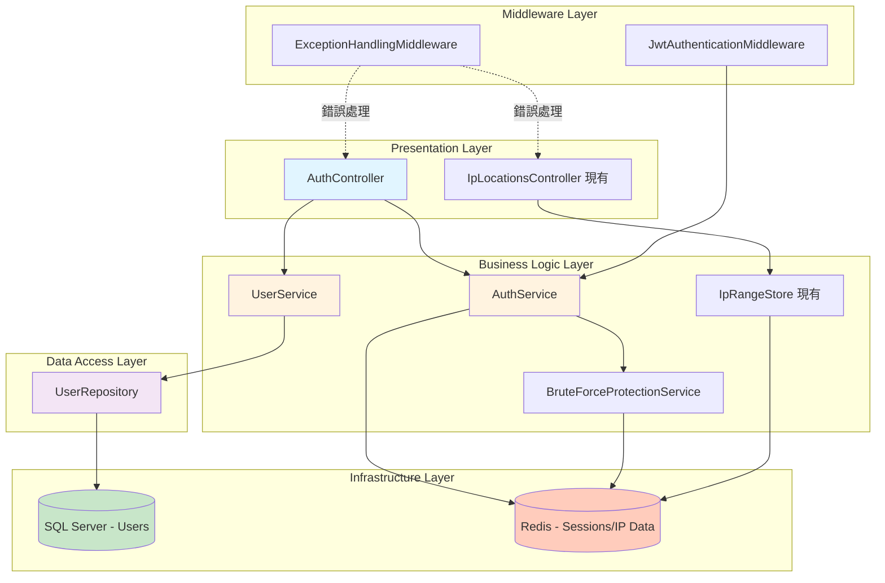
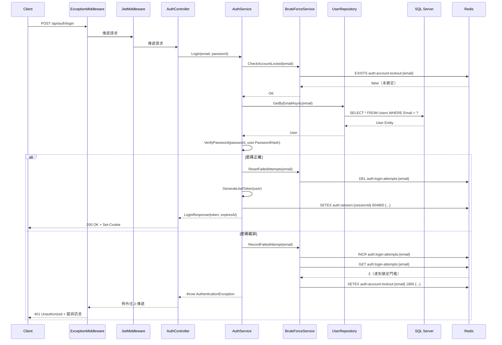

# Feature Design Document - User Authentication

## 版本歷史

| 日期       | 版本 | 變更摘要 | 作者 |
| ---------- | ---- | -------- | ---- |
| 2025-11-03 | 1.0  | 初始建立 | AI   |

## Summary

本功能為 IpLocations.Api 導入完整的使用者身分驗證機制，包含註冊、登入、會話管理、暴力破解防護等核心功能。透過此功能，系統將從開放式 API 轉變為需身分驗證的受保護服務，為未來的配額管理、付費方案及使用者追蹤奠定基礎。

**核心設計原則**：
- **安全第一**：採用 bcrypt 密碼雜湊、JWT Token、HTTP-Only Cookie、暴力破解防護
- **效能優化**：混合使用 Redis（會話/快取）與 SQL Server（持久化），請求處理時間 < 200ms
- **架構整合**：擴展現有分層架構，新增 Services、Repositories、Middleware 層
- **開發者友善**：清晰的錯誤訊息（繁體中文）、RESTful API 設計、完整的 OpenAPI 文件

## Code Reuse Analysis

### 可利用的現有元件

- **IConnectionMultiplexer / IDatabase（Redis）**：
  - **現有用途**：IP 範圍查詢（Sorted Set）
  - **擴展用途**：會話儲存（`auth:session:{id}`）、登入失敗計數（`auth:login-attempts:{email}`）、帳號鎖定狀態（`auth:account-lockout:{email}`）
  - **優勢**：高效能記憶體儲存、TTL 自動過期、原子操作
  
- **ASP.NET Core 依賴注入容器**：
  - **現有用途**：註冊 `IConnectionMultiplexer`、`IpRangeStore` 為單例
  - **擴展用途**：註冊新的 Services（`IUserService`、`IAuthService`）、Repositories（`IUserRepository`）、DbContext（`ApplicationDbContext`）
  
- **Controller 基底類別與路由模式**：
  - **現有模式**：`[ApiController]`、`[Route("api/[controller]")]`
  - **重用方式**：`AuthController` 採用相同模式，保持 API 風格一致
  
- **Swagger/OpenAPI 文件化**：
  - **現有用途**：自動產生 `/api/IpLocations` 端點文件
  - **擴展用途**：自動包含 `/api/auth` 端點，可新增 XML 註解增強說明
  
- **Docker 容器化基礎設施**：
  - **現有配置**：Dockerfile、docker-compose（若有）
  - **擴展用途**：新增 SQL Server 容器服務（`mcr.microsoft.com/mssql/server:2022-latest`）

### 整合點

- **現有系統（IpLocations API）**：
  - 新功能不修改 `IpLocationsController` 與 `IpRangeStore`
  - 未來可在 `IpLocationsController.Get` 加上 `[Authorize]` 屬性以限制存取
  - 透過 JWT Middleware 注入 `HttpContext.User`，可在 Controller 中取得當前使用者資訊
  
- **資料庫連接**：
  - 新增 SQL Server 資料庫，獨立於 Redis
  - 使用 Entity Framework Core 管理資料庫結構與遷移
  - 連線字串存放於 `appsettings.json`（開發）與環境變數（生產）
  
- **Redis 資料隔離**：
  - 使用不同的 Key 前綴區分功能模組：
    - IP 查詢：`ip-to-country:*`
    - 身分驗證：`auth:*`
  - 避免 Key 衝突，維持資料結構清晰

## File Structure

以下為新增或修改的檔案結構：

```
src/IpLocations.Api/
├── Controllers/
│   ├── IpLocationsController.cs         # 現有（未來可新增 [Authorize]）
│   └── AuthController.cs                # 新增：身分驗證端點（註冊、登入、登出、個人資料）
│
├── Services/                             # 新增：業務邏輯層
│   ├── IUserService.cs                  # 介面：使用者管理服務
│   ├── UserService.cs                   # 實作：註冊、查詢個人資料
│   ├── IAuthService.cs                  # 介面：身分驗證服務
│   ├── AuthService.cs                   # 實作：登入、登出、Token 生成/驗證
│   ├── IBruteForceProtectionService.cs  # 介面：暴力破解防護
│   └── BruteForceProtectionService.cs   # 實作：失敗計數、帳號鎖定/解鎖
│
├── Repositories/                         # 新增：資料存取層
│   ├── IUserRepository.cs               # 介面：使用者資料存取
│   └── UserRepository.cs                # 實作：使用 EF Core 操作 Users 表
│
├── Data/                                 # 新增：資料庫相關
│   ├── ApplicationDbContext.cs          # EF Core DbContext
│   ├── Entities/
│   │   └── User.cs                      # 使用者實體（Id, Email, PasswordHash, CreatedAt 等）
│   └── Migrations/                      # EF Core 自動產生的遷移檔案
│
├── Middleware/                           # 新增：中介軟體
│   ├── JwtAuthenticationMiddleware.cs   # JWT Token 驗證，注入使用者身分
│   └── ExceptionHandlingMiddleware.cs   # 全域錯誤處理，統一回應格式
│
├── DTOs/                                 # 新增：資料傳輸物件
│   ├── Auth/
│   │   ├── RegisterRequest.cs           # 註冊請求（Email, Password）
│   │   ├── LoginRequest.cs              # 登入請求（Email, Password）
│   │   ├── LoginResponse.cs             # 登入回應（Token, ExpiresAt）
│   │   └── UserProfileResponse.cs       # 個人資料回應（Email, CreatedAt）
│   └── Common/
│       └── ErrorResponse.cs             # 錯誤回應（Code, Message）
│
├── Validators/                           # 新增：輸入驗證
│   ├── EmailValidator.cs                # 電子郵件格式驗證
│   └── PasswordValidator.cs             # 密碼強度驗證（8 字元、大小寫、數字、特殊符號）
│
├── Extensions/                           # 新增：擴展方法
│   ├── ServiceCollectionExtensions.cs   # DI 註冊擴展（統一管理 AddServices、AddRepositories 等）
│   └── ClaimsPrincipalExtensions.cs     # 從 JWT Claims 提取使用者資訊（GetUserId、GetEmail）
│
├── Misc/                                 # 擴展現有目錄
│   ├── IpConverter.cs                   # 現有：IP 轉換工具
│   ├── PasswordHasher.cs                # 新增：bcrypt 密碼雜湊與驗證
│   └── JwtTokenGenerator.cs             # 新增：JWT Token 生成工具
│
├── Constants/
│   ├── RedisKeyConst.cs                 # 現有：IP 查詢 Redis Key
│   ├── AuthRedisKeyConst.cs             # 新增：身分驗證 Redis Key（會話、失敗計數、鎖定）
│   └── ErrorCodeConst.cs                # 新增：錯誤碼常數
│
├── Exceptions/                           # 新增：自訂例外
│   ├── ValidationException.cs           # 輸入驗證例外
│   ├── AuthenticationException.cs       # 身分驗證例外
│   └── AccountLockedException.cs        # 帳號鎖定例外
│
├── Program.cs                            # 修改：註冊新服務、Middleware、DbContext
├── appsettings.json                      # 修改：新增 JWT 設定、資料庫連線字串
├── appsettings.Development.json          # 修改：本地開發環境設定
└── IpLocations.Api.csproj                # 修改：新增 NuGet 套件參考
```

## Architecture

本功能在現有單體式分層架構基礎上進行擴展，保持整體架構風格一致：

### 擴展後的分層架構



### 依賴方向

- **向內依賴**：Controllers → Services → Repositories → Infrastructure
- **介面隔離**：Services 與 Repositories 定義介面，支援依賴注入與單元測試
- **橫切關注點**：Middleware 處理驗證與錯誤，不侵入業務邏輯

### 請求處理流程（登入為例）



### 與現有架構整合

- **IpLocationsController**：維持不變，未來可加上 `[Authorize]` 屬性
- **IpRangeStore**：維持不變，繼續使用 Redis Sorted Set 查詢 IP 範圍
- **Redis**：擴展為兩個功能區（透過 Key 前綴區分）：
  - `ip-to-country:*`：IP 範圍查詢
  - `auth:*`：身分驗證資料（會話、失敗記錄、鎖定狀態）

## Components and Interfaces

### AuthController
- **目的**：處理身分驗證相關的 HTTP 請求（註冊、登入、登出、個人資料查詢）
- **介面（HTTP 端點）**：
  - `POST /api/auth/register`：註冊新帳號
  - `POST /api/auth/login`：使用者登入
  - `POST /api/auth/logout`：使用者登出
  - `GET /api/auth/profile`：查詢個人資料（需驗證）
- **依賴**：`IUserService`、`IAuthService`
- **整合/擴展**：遵循現有 Controller 設計模式（`[ApiController]`、`[Route("api/[controller]")]`）

### UserService
- **目的**：封裝使用者管理業務邏輯（註冊、查詢個人資料）
- **介面（公開方法）**：
  - `Task<Guid> RegisterAsync(string email, string password)`：註冊新使用者，回傳使用者 ID
  - `Task<UserProfileResponse> GetProfileAsync(Guid userId)`：查詢使用者個人資料
- **依賴**：`IUserRepository`、`EmailValidator`、`PasswordValidator`、`PasswordHasher`
- **整合/擴展**：新增元件，實作註冊流程（驗證輸入 → 檢查重複 → 加密密碼 → 儲存使用者）

### AuthService
- **目的**：封裝身分驗證業務邏輯（登入、登出、Token 生成/驗證）
- **介面（公開方法）**：
  - `Task<LoginResponse> LoginAsync(string email, string password)`：驗證憑證並產生 Token
  - `Task LogoutAsync(Guid userId, string sessionId)`：登出並銷毀會話
  - `Task<bool> ValidateSessionAsync(string sessionId)`：驗證會話是否有效
- **依賴**：`IUserRepository`、`IBruteForceProtectionService`、`IDatabase`（Redis）、`JwtTokenGenerator`、`PasswordHasher`
- **整合/擴展**：新增元件，整合暴力破解防護、密碼驗證、會話管理

### BruteForceProtectionService
- **目的**：防護暴力破解攻擊（失敗計數、帳號鎖定/解鎖）
- **介面（公開方法）**：
  - `Task<bool> IsAccountLockedAsync(string email)`：檢查帳號是否被鎖定
  - `Task RecordFailedAttemptAsync(string email)`：記錄登入失敗，達 3 次自動鎖定
  - `Task ResetFailedAttemptsAsync(string email)`：重置失敗計數（登入成功時呼叫）
- **依賴**：`IDatabase`（Redis）
- **整合/擴展**：新增元件，使用 Redis 儲存失敗記錄與鎖定狀態，利用 TTL 自動解鎖（30 分鐘）

### UserRepository
- **目的**：封裝使用者資料存取邏輯（CRUD 操作）
- **介面（公開方法）**：
  - `Task<User?> GetByIdAsync(Guid id)`：依 ID 查詢使用者
  - `Task<User?> GetByEmailAsync(string email)`：依電子郵件查詢使用者
  - `Task<bool> EmailExistsAsync(string email)`：檢查電子郵件是否已註冊
  - `Task<Guid> CreateAsync(User user)`：建立新使用者，回傳 ID
- **依賴**：`ApplicationDbContext`
- **整合/擴展**：新增元件，使用 EF Core 操作 SQL Server 資料庫

### ApplicationDbContext
- **目的**：EF Core 資料庫上下文，管理實體與資料庫對應關係
- **介面（公開屬性）**：
  - `DbSet<User> Users`：使用者資料集
- **依賴**：`Microsoft.EntityFrameworkCore.SqlServer`
- **整合/擴展**：新增元件，定義資料庫 Schema（Users 表結構、索引、約束）

### JwtAuthenticationMiddleware
- **目的**：驗證 HTTP 請求中的 JWT Token，並將使用者身分注入 `HttpContext.User`
- **介面（中介軟體）**：
  - 從 Cookie 中提取 JWT Token
  - 驗證 Token 簽章與有效期
  - 從 Token Payload 提取 Claims（UserId、Email、SessionId）
  - 檢查 Redis 中會話是否存在（支援主動登出）
  - 若驗證成功，設定 `HttpContext.User`；否則返回 401 Unauthorized
- **依賴**：`IAuthService`、`JwtTokenGenerator`
- **整合/擴展**：新增元件，插入 ASP.NET Core 請求管線（置於 `UseAuthorization` 之前）

### ExceptionHandlingMiddleware
- **目的**：全域攔截例外，統一錯誤回應格式與語言（繁體中文）
- **介面（中介軟體）**：
  - 捕捉 `ValidationException`、`AuthenticationException`、`AccountLockedException` 等自訂例外
  - 根據例外類型回傳對應 HTTP 狀態碼與錯誤訊息
  - 開發環境回傳 Stack Trace，生產環境回傳通用訊息
- **依賴**：無
- **整合/擴展**：新增元件，插入請求管線最前方（`app.UseMiddleware<ExceptionHandlingMiddleware>()`）

### PasswordHasher（工具類別）
- **目的**：封裝密碼雜湊與驗證邏輯（使用 bcrypt）
- **介面（靜態方法）**：
  - `string HashPassword(string password)`：使用 bcrypt 雜湊密碼（Work Factor = 12）
  - `bool VerifyPassword(string password, string hashedPassword)`：驗證密碼是否正確
- **依賴**：`BCrypt.Net-Next`
- **整合/擴展**：新增於 `Misc/` 目錄，遵循現有工具類別命名慣例（如 `IpConverter`）

### JwtTokenGenerator（工具類別）
- **目的**：封裝 JWT Token 生成與解析邏輯
- **介面（靜態方法）**：
  - `string GenerateToken(Guid userId, string email, string sessionId, TimeSpan expiry)`：生成 JWT Token
  - `ClaimsPrincipal? ValidateToken(string token)`：驗證 Token 並回傳 Claims
- **依賴**：`System.IdentityModel.Tokens.Jwt`、組態（SecretKey、Issuer、Audience）
- **整合/擴展**：新增於 `Misc/` 目錄

### EmailValidator / PasswordValidator
- **目的**：驗證輸入格式（電子郵件、密碼強度）
- **介面**：
  - `bool IsValid(string input)`：驗證輸入是否合法
  - `string GetErrorMessage()`：回傳錯誤訊息（繁體中文）
- **依賴**：無（使用 Regex 或邏輯判斷）
- **整合/擴展**：新增於 `Validators/` 目錄

## Data Models

### User（使用者實體）

儲存於 SQL Server `Users` 表：

| 欄位名稱      | 資料型別      | 說明                           | 約束                          |
| ------------- | ------------- | ------------------------------ | ----------------------------- |
| Id            | uniqueidentifier (Guid) | 使用者唯一識別碼       | PRIMARY KEY                   |
| Email         | nvarchar(255) | 電子郵件地址                   | UNIQUE, NOT NULL              |
| PasswordHash  | nvarchar(255) | bcrypt 雜湊後的密碼            | NOT NULL                      |
| CreatedAt     | datetime2     | 註冊日期時間（UTC）            | NOT NULL, DEFAULT GETUTCDATE() |
| UpdatedAt     | datetime2     | 最後更新日期時間（UTC）        | NOT NULL, DEFAULT GETUTCDATE() |

**索引**：
- `IX_Users_Email`：唯一索引，加速電子郵件查詢並防止重複

**C# 實體定義**（位於 `Data/Entities/User.cs`）：
```csharp
public class User
{
    public Guid Id { get; set; }
    public string Email { get; set; } = string.Empty;
    public string PasswordHash { get; set; } = string.Empty;
    public DateTime CreatedAt { get; set; }
    public DateTime UpdatedAt { get; set; }
}
```

### Session（會話資料）

儲存於 Redis，不持久化至資料庫：

**Redis Key**: `auth:session:{sessionId}`  
**TTL**: 604800 秒（7 天）  
**Value**: JSON 格式

```json
{
  "userId": "3fa85f64-5717-4562-b3fc-2c963f66afa6",
  "email": "user@example.com",
  "createdAt": "2025-11-03T10:30:00Z",
  "expiresAt": "2025-11-10T10:30:00Z"
}
```

### LoginAttempt（登入失敗記錄）

儲存於 Redis，不持久化至資料庫：

**Redis Key**: `auth:login-attempts:{email}`  
**Value**: Integer（失敗次數）  
**TTL**: 無（由應用程式邏輯控制，成功登入時刪除）

### AccountLockout（帳號鎖定狀態）

儲存於 Redis，不持久化至資料庫：

**Redis Key**: `auth:account-lockout:{email}`  
**TTL**: 1800 秒（30 分鐘）  
**Value**: JSON 格式

```json
{
  "email": "user@example.com",
  "lockedAt": "2025-11-03T10:30:00Z",
  "unlockAt": "2025-11-03T11:00:00Z"
}
```

## Error Handling

### 錯誤情境與處理策略

#### 1. 輸入驗證失敗
- **情境**：電子郵件格式錯誤、密碼強度不足、欄位為空白
- **處理**：
  - 拋出 `ValidationException`
  - `ExceptionHandlingMiddleware` 攔截並回傳 400 Bad Request
- **使用者影響**：
  - HTTP 狀態碼：400
  - 錯誤訊息範例：
    ```json
    {
      "error": {
        "code": "VALIDATION_ERROR",
        "message": "密碼必須至少 8 字元,並包含大寫字母、小寫字母、數字與特殊符號"
      }
    }
    ```

#### 2. 電子郵件已被註冊
- **情境**：註冊時使用已存在的電子郵件
- **處理**：
  - `UserService.RegisterAsync` 檢查 `EmailExistsAsync`
  - 拋出 `ValidationException`（錯誤碼 `EMAIL_ALREADY_EXISTS`）
  - `ExceptionHandlingMiddleware` 攔截並回傳 409 Conflict
- **使用者影響**：
  - HTTP 狀態碼：409
  - 錯誤訊息：「此電子郵件已被註冊，請使用其他電子郵件或直接登入」

#### 3. 登入失敗（帳號或密碼錯誤）
- **情境**：使用者輸入錯誤的帳號或密碼
- **處理**：
  - `AuthService.LoginAsync` 驗證密碼失敗
  - 呼叫 `BruteForceProtectionService.RecordFailedAttemptAsync` 記錄失敗
  - 拋出 `AuthenticationException`
  - `ExceptionHandlingMiddleware` 攔截並回傳 401 Unauthorized
  - **注意**：錯誤訊息統一為「帳號或密碼錯誤」，不區分帳號不存在或密碼錯誤（防止帳號枚舉）
- **使用者影響**：
  - HTTP 狀態碼：401
  - 錯誤訊息：「帳號或密碼錯誤」

#### 4. 帳號被鎖定
- **情境**：連續 3 次登入失敗，帳號被鎖定 30 分鐘
- **處理**：
  - `BruteForceProtectionService.IsAccountLockedAsync` 檢查 Redis 中的鎖定狀態
  - 若鎖定，拋出 `AccountLockedException`
  - `ExceptionHandlingMiddleware` 攔截並回傳 403 Forbidden
- **使用者影響**：
  - HTTP 狀態碼：403
  - 錯誤訊息：「帳號已被鎖定，請於 30 分鐘後再試」

#### 5. 會話過期
- **情境**：使用者使用超過 7 天的 Token 嘗試存取 API
- **處理**：
  - `JwtAuthenticationMiddleware` 驗證 Token 過期時間
  - 檢查 Redis 中會話是否存在（若不存在則過期）
  - 回傳 401 Unauthorized
- **使用者影響**：
  - HTTP 狀態碼：401
  - 錯誤訊息：「會話已過期，請重新登入」

#### 6. 未授權存取
- **情境**：未登入使用者嘗試存取需驗證的端點（如 `/api/auth/profile`）
- **處理**：
  - `JwtAuthenticationMiddleware` 檢查 Cookie 中的 Token
  - 若 Token 不存在或無效，設定 `HttpContext.Response.StatusCode = 401`
  - Controller 中使用 `[Authorize]` 屬性檢查使用者身分
- **使用者影響**：
  - HTTP 狀態碼：401
  - 錯誤訊息：「未授權，請先登入」

#### 7. 伺服器內部錯誤
- **情境**：資料庫連線失敗、Redis 不可用、未預期的例外
- **處理**：
  - `ExceptionHandlingMiddleware` 捕捉所有未處理例外
  - 記錄詳細錯誤日誌（包含 Stack Trace）
  - 開發環境：回傳詳細錯誤資訊
  - 生產環境：回傳通用訊息「伺服器錯誤，請稍後再試」
- **使用者影響**：
  - HTTP 狀態碼：500
  - 錯誤訊息（生產環境）：「伺服器錯誤，請稍後再試」

### 錯誤碼對照表

| 錯誤碼               | HTTP 狀態碼 | 中文訊息                                                   |
| -------------------- | ----------- | ---------------------------------------------------------- |
| VALIDATION_ERROR     | 400         | （依驗證規則動態產生，如「電子郵件為必填欄位」）           |
| EMAIL_ALREADY_EXISTS | 409         | 此電子郵件已被註冊，請使用其他電子郵件或直接登入           |
| INVALID_CREDENTIALS  | 401         | 帳號或密碼錯誤                                             |
| ACCOUNT_LOCKED       | 403         | 帳號已被鎖定，請於 30 分鐘後再試                           |
| SESSION_EXPIRED      | 401         | 會話已過期，請重新登入                                     |
| UNAUTHORIZED         | 401         | 未授權，請先登入                                           |
| INTERNAL_ERROR       | 500         | 伺服器錯誤，請稍後再試                                     |

## Testing Strategy

測試策略依循 spec.md 定義的 Feature Scenarios（SCN-001 ~ SCN-044），確保所有功能需求與驗收標準均被測試覆蓋。

### Unit Testing

**目標**：測試獨立元件的業務邏輯，使用 Mock 隔離外部依賴。

**測試範圍**：
- **PasswordHasher**：
  - 驗證密碼雜湊後無法還原
  - 驗證相同密碼每次雜湊結果不同（Salt 隨機性）
  - 驗證正確密碼可通過驗證
  - 驗證錯誤密碼無法通過驗證
  
- **EmailValidator**：
  - 驗證有效電子郵件格式（包含 @、網域名稱）
  - 驗證無效格式被拒絕（缺少 @、缺少網域）
  - 對應 SCN-004、SCN-005
  
- **PasswordValidator**：
  - 驗證密碼長度限制（< 8 字元被拒絕）
  - 驗證密碼強度規則（缺少大寫/小寫/數字/特殊符號）
  - 對應 SCN-007、SCN-009 ~ SCN-012
  
- **UserService**：
  - Mock `IUserRepository`
  - 測試註冊流程（驗證輸入 → 檢查重複 → 加密密碼 → 呼叫 Repository）
  - 測試電子郵件重複時拋出例外
  - 對應 SCN-014、SCN-015
  
- **AuthService**：
  - Mock `IUserRepository`、`IBruteForceProtectionService`、`IDatabase`
  - 測試登入流程（驗證密碼 → 生成 Token → 建立會話）
  - 測試登入失敗時記錄失敗次數
  - 測試登入成功時重置失敗計數
  - 對應 SCN-017 ~ SCN-021、SCN-035
  
- **BruteForceProtectionService**：
  - Mock `IDatabase`（Redis）
  - 測試失敗計數累積（1 次、2 次、3 次）
  - 測試達到 3 次時自動鎖定
  - 測試鎖定狀態檢查
  - 測試重置失敗計數
  - 對應 SCN-029 ~ SCN-036

**測試框架**：xUnit、FluentAssertions、Moq（Mock 框架）

### Integration Testing

**目標**：測試完整的 HTTP 請求/回應流程，驗證各元件整合後的行為。

**測試環境**：
- 使用 `WebApplicationFactory<Program>` 建立測試伺服器
- 使用 Testcontainers 啟動真實的 SQL Server 與 Redis 容器
- 每個測試案例執行前重置資料庫與 Redis 狀態

**測試範圍**：
- **註冊流程（POST /api/auth/register）**：
  - 測試成功註冊（SCN-015）
  - 測試欄位為空白（SCN-001 ~ SCN-003）
  - 測試電子郵件格式錯誤（SCN-004、SCN-005）
  - 測試密碼長度不足（SCN-007）
  - 測試密碼強度不足（SCN-009 ~ SCN-012）
  - 測試電子郵件重複（SCN-014）
  - 驗證密碼以加密格式儲存（SCN-016）
  
- **登入流程（POST /api/auth/login）**：
  - 測試正確憑證登入（SCN-017）
  - 測試帳號不存在（SCN-018）
  - 測試密碼錯誤（SCN-019）
  - 測試登入失敗記錄（SCN-020）
  - 測試錯誤訊息一致性（SCN-021）
  - 測試連續失敗 3 次鎖定（SCN-029）
  - 測試鎖定期間無法登入（SCN-031、SCN-032）
  - 測試 30 分鐘後自動解鎖（SCN-033、SCN-034）
  - 測試登入成功後重置失敗計數（SCN-035、SCN-036）
  
- **會話管理（會話驗證與登出）**：
  - 測試會話建立時記錄時間（SCN-022）
  - 測試有效會話期間存取 API（SCN-023、SCN-024）
  - 測試會話過期後拒絕存取（SCN-025、SCN-026）
  - 測試登出功能（SCN-027、SCN-028）
  
- **個人資料查詢（GET /api/auth/profile）**：
  - 測試已登入使用者存取（SCN-041、SCN-043）
  - 測試未登入使用者被拒絕（SCN-042）
  - 測試不顯示密碼資訊（SCN-044）
  
- **錯誤訊息**：
  - 測試所有錯誤訊息以繁體中文顯示（SCN-037 ~ SCN-040）

**測試框架**：xUnit、FluentAssertions、Testcontainers.SqlServer、Testcontainers.Redis

### End-to-End Testing

**目標**：模擬真實使用者操作流程，驗證完整功能鏈路。

**測試場景**：
- **完整註冊與登入流程**：
  1. 使用者註冊帳號
  2. 註冊成功
  3. 使用該帳號登入
  4. 登入成功並收到 Token
  5. 使用 Token 存取個人資料
  6. 成功查詢個人資料
  
- **暴力破解防護流程**：
  1. 使用者嘗試登入（密碼錯誤）
  2. 連續失敗 3 次
  3. 帳號被鎖定
  4. 嘗試使用正確密碼登入，仍被拒絕
  5. 等待 30 分鐘
  6. 再次嘗試登入，成功解鎖並登入
  
- **會話過期流程**：
  1. 使用者登入
  2. 等待 7 天（使用 Mock 時間或手動刪除 Redis 會話）
  3. 嘗試存取 API
  4. 收到「會話已過期」錯誤
  5. 重新登入
  6. 成功存取 API

**測試工具**：可使用 Postman Collection 或自動化 E2E 測試框架（如 Playwright、Selenium）

### 測試覆蓋率目標

- **單元測試**：程式碼覆蓋率 ≥ 80%（核心業務邏輯應達 100%）
- **整合測試**：所有 API 端點均有對應測試
- **Scenarios 覆蓋**：SCN-001 ~ SCN-044 全數覆蓋

### 特殊測試策略

#### 時序攻擊防護測試（NFR-002）
- 使用 Benchmark 測試驗證正確密碼與錯誤密碼的驗證時間
- 確保兩者時間差異在統計上不顯著（p-value > 0.05）

#### 會話識別碼隨機性測試（NFR-003）
- 生成 10,000 個 Session ID
- 驗證無重複
- 使用統計測試驗證隨機性（Chi-Square Test）

#### 效能測試（NFR-001）
- 使用 BenchmarkDotNet 或 Apache JMeter 測試註冊與登入端點
- 目標：95% 請求處理時間 < 200ms（排除網路延遲）
- 測試場景：併發 100 使用者，持續 1 分鐘

## 設計文件版本與變更追蹤

| 日期       | 版本 | 變更摘要 | 作者 |
| ---------- | ---- | -------- | ---- |
| 2025-11-03 | 1.0  | 初始建立 | AI   |

---

**附註**：
- 本設計文件應與 `research.md`（技術研究）、`contracts/auth-api.yaml`（API 規格）搭配閱讀
- 實作過程中若發現設計問題或需調整，應更新本文件並記錄版本變更
- 所有設計決策均需追溯至 `spec.md` 的功能需求（FR-XXX）或非功能需求（NFR-XXX）
