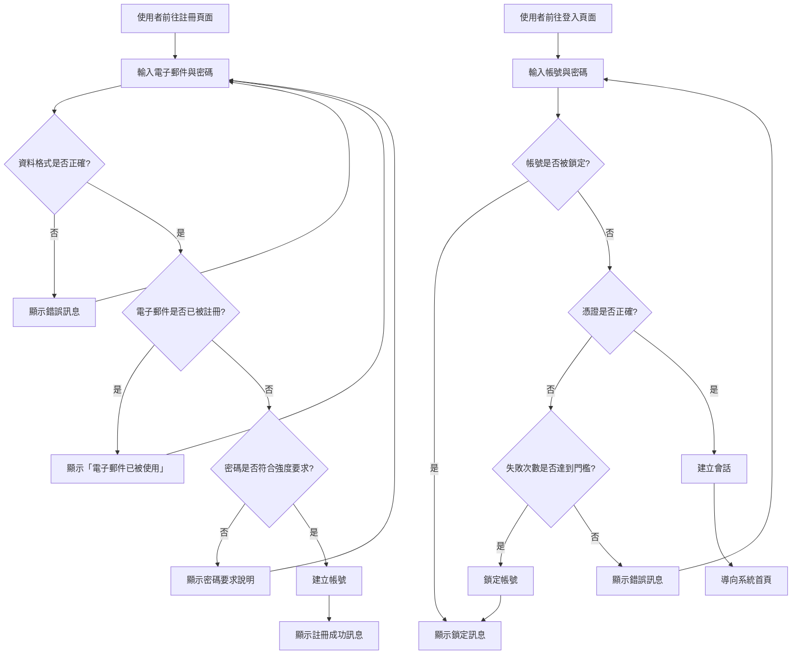

# Product Requirements Document (PRD)

## Glossary

- **使用者 (User)**：註冊並使用 IpLocations.Api 服務的應用程式開發者、系統整合工程師或資料分析人員
- **註冊 (Registration)**：使用者建立新帳號的過程，包含提供基本資訊並設定登入憑證
- **登入 (Login)**：使用者使用帳號與密碼驗證身分，取得系統存取權限的過程
- **驗證 (Authentication)**：系統確認使用者身分的過程，確保只有合法使用者能存取服務
- **會話 (Session)**：使用者成功登入後，系統維持其已驗證狀態的時間區間，有效期限為 7 天，平衡便利性與安全性
- **帳號鎖定 (Account Lockout)**：當登入嘗試失敗達到一定次數後，系統暫時停用該帳號的防護機制，30 分鐘後自動解除
- **密碼強度 (Password Strength)**：密碼的複雜度與安全性要求，最少 8 字元且需包含大小寫字母、數字與特殊符號
- **資料保留政策 (Data Retention Policy)**：使用者註冊資料在帳號活躍期間永久保留，未來版本將提供使用者主動刪除帳號功能以符合隱私法規

## Executive Summary

為提升 IpLocations.Api 服務的安全性與存取控制，本需求旨在導入使用者註冊與登入機制。目前系統缺乏身分驗證功能，任何人皆可無限制地呼叫 API，導致潛在的濫用風險與資源消耗問題。

透過實作安全的註冊與登入功能，我們能夠：
- **身分識別**：明確識別每個 API 使用者，建立使用者責任機制
- **存取控制**：防止未授權存取，保護服務資源
- **使用追蹤**：記錄使用者行為，支援稽核與分析需求
- **服務品質**：為未來實施配額管理、付費方案等功能奠定基礎

核心功能包含：使用者註冊、安全登入、密碼強度驗證、登入失敗防護、會話管理。

## Problem Statement

**現狀與痛點**：
IpLocations.Api 目前為開放式 API，任何人皆可直接呼叫服務端點，存在以下問題：
1. **無法追蹤使用者**：無法識別呼叫來源，難以分析使用模式或異常行為
2. **濫用風險**：惡意使用者可能大量呼叫 API，消耗系統資源並影響其他使用者
3. **無存取控制**：無法針對不同使用者設定存取權限或使用配額
4. **安全疑慮**：敏感資料（如 IP 查詢歷史）無法與特定使用者關聯，不符合資料管理最佳實務

**問題影響**：
- 若遭受 DDoS 攻擊或惡意爬蟲，服務可用性將受到嚴重影響
- 無法區分合法與惡意流量，難以實施防護措施
- 無法實現商業化策略（如免費與付費方案）
- 不符合企業級服務的安全標準，限制潛在客戶採用意願

**現有解決方案不足之處**：
- IP 白名單：管理成本高，無法應對動態 IP 使用者
- API Key 發放（無註冊流程）：缺乏正式的使用者管理機制，難以追蹤與撤銷

**緊迫性與重要性**：
隨著服務使用量成長，缺乏身分驗證的風險將日益增加。在開放更多功能或推廣服務前，必須優先建立基礎的安全機制，以確保服務的長期穩定與可持續發展。

## Proposed Solution

實作一套完整的使用者註冊與登入機制，讓使用者能夠安全地建立帳號並驗證身分，取得 API 存取權限。

**核心流程**：

1. **註冊流程**：
   - 使用者提供基本資訊（電子郵件、密碼）建立帳號
   - 系統驗證資料格式與唯一性，確保密碼符合安全要求
   - 註冊成功後，使用者即可使用帳號登入

2. **登入流程**：
   - 使用者輸入帳號與密碼進行身分驗證
   - 系統驗證憑證正確性，並防護暴力破解攻擊
   - 驗證成功後，系統建立會話狀態，使用者可在會話期間存取 API

3. **安全防護**：
   - 密碼強度驗證：拒絕過於簡單的密碼，降低帳號被破解風險
   - 登入失敗防護：限制失敗嘗試次數，達到門檻後暫時鎖定帳號
   - 會話管理：自動過期機制，降低會話劫持風險

**使用者體驗重點**：
- 註冊與登入流程簡潔直觀，減少使用障礙
- 明確的錯誤提示訊息，協助使用者快速解決問題
- 透明的安全規則說明（如密碼要求、鎖定機制），建立使用者信任

**業務價值**：
- 建立使用者基礎資料庫，支援未來功能擴展（如配額管理、付費方案）
- 提升服務安全性與可信度，符合企業級服務標準
- 為使用者行為分析與服務優化提供數據基礎

## User Scenario

### Personas

| 角色 | 描述 | 主要目標 |
|------|------|----------|
| 應用程式開發者 | 開發需要 IP 地理位置功能的 Web 或行動應用程式 | 快速註冊帳號並取得 API 存取權限，整合至開發專案中 |
| 系統整合工程師 | 負責將 IP 查詢服務整合至企業現有系統 | 以企業帳號註冊，確保服務安全性與可追蹤性 |
| 資料分析人員 | 使用 IP 查詢服務進行地理分布分析 | 登入系統並安全地存取歷史查詢資料 |

### Scenario Description

**場景一：新使用者註冊**
Alex 是一名應用程式開發者，正在開發一個電商網站，需要根據使用者 IP 位址顯示對應的語言與幣別。他聽說 IpLocations.Api 提供快速的 IP 查詢服務，決定試用看看。

Alex 前往 IpLocations.Api 網站，點擊「註冊」按鈕，輸入他的工作電子郵件與密碼。系統提示密碼需要包含至少 8 個字元，他調整後再次提交。註冊成功後，系統顯示歡迎訊息，Alex 現在可以使用帳號登入並開始使用 API。

**場景二：使用者登入與失敗處理**
隔天，Alex 想要繼續測試 API 功能。他前往登入頁面，輸入帳號與密碼。第一次因為記錯密碼而失敗，系統顯示「帳號或密碼錯誤」訊息。Alex 重新輸入後成功登入，進入系統儀表板。

後來 Alex 的同事 Jordan 好奇地嘗試登入 Alex 的帳號，連續輸入錯誤密碼 3 次後，系統鎖定帳號並顯示「帳號已被鎖定，請於 30 分鐘後再試」。Alex 稍後重新登入時，發現帳號已自動解鎖。

### User Flow

## User Stories

### US-001 - 使用者註冊帳號 (Priority: P1)

作為一個新使用者，我希望能夠註冊帳號，以便取得 API 存取權限並開始使用服務。

**為何此優先級**：註冊功能是使用者進入系統的第一步，屬於核心必備功能。沒有註冊功能，使用者無法建立帳號，後續的登入與 API 存取皆無法實現。

**獨立測試**：準備多組測試資料（有效與無效的電子郵件、密碼組合），透過註冊介面提交，驗證系統回應符合各項驗收標準。

**Acceptance Criteria**：

- **AC-001**：系統應拒絕空白的電子郵件或密碼 (普遍性)
- **AC-002**：系統應拒絕格式不正確的電子郵件（例如缺少 @ 符號） (普遍性)
- **AC-003**：系統應拒絕少於 8 字元的密碼 (普遍性)
- **AC-004**：系統應拒絕不包含大小寫字母、數字與特殊符號的密碼 (普遍性)
- **AC-005**：當使用者提交註冊表單時，如果電子郵件已被其他帳號使用，則系統應顯示「此電子郵件已被註冊」訊息 (事件驅動)
- **AC-006**：當使用者成功註冊時，則系統應儲存帳號資訊並顯示「註冊成功」訊息 (事件驅動)
- **AC-007**：系統應以加密方式儲存密碼，確保密碼不以明文形式保存 (普遍性)

### US-002 - 使用者安全登入 (Priority: P1)

作為一個已註冊使用者，我希望能夠安全地登入系統，以便驗證我的身分並存取 API 服務。

**為何此優先級**：登入功能是使用者驗證身分的必要機制，缺少此功能將無法實現存取控制與安全防護。屬於核心必備功能。

**獨立測試**：使用已註冊的測試帳號，嘗試以正確與錯誤的密碼登入，驗證系統回應與會話建立狀態。

**Acceptance Criteria**：

- **AC-001**：當使用者輸入正確的帳號與密碼時，則系統應建立會話並導向系統首頁 (事件驅動)
- **AC-002**：當使用者輸入錯誤的帳號或密碼時，則系統應顯示「帳號或密碼錯誤」訊息 (事件驅動)
- **AC-003**：系統應在登入失敗時記錄失敗次數，以供後續防護機制使用 (普遍性)
- **AC-004**：系統應不區分「帳號不存在」與「密碼錯誤」的錯誤訊息，以防止帳號枚舉攻擊 (普遍性)

### US-003 - 會話管理與自動登出 (Priority: P1)

作為一個已登入使用者,我希望系統能夠維持我的登入狀態一段時間,同時在一定期限後自動登出,以平衡使用便利性與安全性。

**為何此優先級**：會話管理是確保系統安全的關鍵機制。沒有會話過期機制,被盜用的會話可能長期有效,增加安全風險。屬於核心必備功能。

**獨立測試**：登入後記錄會話建立時間,等待設定的期限後嘗試存取 API,驗證系統是否要求重新登入。

**Acceptance Criteria**：

- **AC-001**：當使用者成功登入時,則系統應建立會話並記錄建立時間 (事件驅動)
- **AC-002**：在會話有效期間,使用者應能夠存取 API 服務而無需重新登入 (狀態驅動)
- **AC-003**：當會話超過 7 天有效期限時,如果使用者嘗試存取 API,則系統應要求重新登入 (事件驅動)
- **AC-004**：當使用者執行登出操作時,則系統應立即終止會話 (事件驅動)

### US-004 - 防護暴力破解攻擊 (Priority: P1)

作為系統管理者,我希望系統能夠自動偵測並防護暴力破解攻擊,以保護使用者帳號安全。

**為何此優先級**：暴力破解防護是基本的安全要求,若缺少此機制,惡意使用者可以無限次嘗試密碼,極易導致帳號被破解。屬於核心必備功能。

**獨立測試**：使用自動化腳本連續以錯誤密碼嘗試登入同一帳號,驗證系統是否在達到門檻後鎖定帳號並拒絕登入。

**Acceptance Criteria**：

- **AC-001**：當同一帳號連續登入失敗達到 3 次時,則系統應鎖定該帳號 (事件驅動)
- **AC-002**：當帳號被鎖定時,如果使用者嘗試登入,則系統應顯示「帳號已被鎖定,請於 30 分鐘後再試」訊息 (事件驅動)
- **AC-003**：系統應在帳號鎖定 30 分鐘後自動解除鎖定狀態 (狀態驅動)
- **AC-004**：當使用者成功登入時,則系統應重置該帳號的登入失敗次數 (事件驅動)

### US-005 - 明確的錯誤訊息提示 (Priority: P2)

作為使用者,我希望在註冊或登入失敗時能收到明確的錯誤訊息,以便快速了解問題並修正。

**為何此優先級**：明確的錯誤訊息能顯著提升使用者體驗,減少挫折感與客服諮詢量。但系統在沒有此功能時仍可正常運作(僅使用通用錯誤訊息),因此屬於重要但非核心的功能。

**獨立測試**：刻意製造各種錯誤情境(無效電子郵件、弱密碼、重複註冊等),驗證系統回應的訊息是否清晰且有助於使用者修正。

**Acceptance Criteria**：

- **AC-001**：當使用者提交無效格式的電子郵件時,則系統應顯示「請輸入有效的電子郵件格式」 (事件驅動)
- **AC-002**：當使用者設定的密碼不符合強度要求時,則系統應顯示具體的密碼規則說明 (事件驅動)
- **AC-003**：當使用者嘗試註冊已存在的電子郵件時,則系統應顯示「此電子郵件已被註冊,請使用其他電子郵件或直接登入」 (事件驅動)
- **AC-004**：所有錯誤訊息應以繁體中文顯示,語氣友善且具建設性 (普遍性)

### US-006 - 查看註冊使用者資訊 (Priority: P3)

作為已登入使用者,我希望能夠查看我的帳號基本資訊,以便確認註冊資料正確。

**為何此優先級**：此功能優化使用者體驗,但不影響核心註冊與登入流程。屬於增值功能,可在基本功能完成後再實作。

**獨立測試**：登入後前往個人資料頁面,驗證顯示的資訊與註冊時輸入的資料一致。

**Acceptance Criteria**：

- **AC-001**：在已登入狀態期間,使用者應能夠存取個人資料頁面 (狀態驅動)
- **AC-002**：系統應顯示使用者的電子郵件與註冊日期 (普遍性)
- **AC-003**：系統應不顯示密碼資訊,僅提供修改密碼的連結 (普遍性)

## Impact Scope

- **現有 API 存取流程**：導入身分驗證後,所有 API 端點將要求使用者先登入才能呼叫。未登入使用者將收到「未授權」錯誤,需先完成註冊與登入流程。
- **開發者整合體驗**：開發者在整合 IpLocations.Api 時,需先註冊帳號並在 API 請求中附帶驗證資訊。這增加了初始設定步驟,但提升了長期使用的安全性。
- **系統監控與分析**：有了使用者身分資訊後,系統可以更精確地追蹤每個使用者的 API 呼叫量、錯誤率與使用模式,為服務優化提供數據支援。

## Success Metrics

- **註冊完成率**：使用者開始註冊流程後成功完成註冊的比例 > 80%
- **登入成功率**：使用者首次嘗試登入的成功率 > 90%
- **帳號鎖定誤報率**：合法使用者因忘記密碼而觸發帳號鎖定的比例 < 5%
- **會話平均持續時間**：使用者單次登入後的活躍使用時間,作為使用者黏性指標
- **安全事件下降率**：導入身分驗證後,未授權存取嘗試與異常流量比例下降 > 70%

## Out of Scope

以下功能不在本次需求範圍內,可能於後續版本考慮：

- **第三方登入整合**（如 Google、GitHub OAuth）
- **雙因素驗證 (2FA)**
- **忘記密碼與密碼重設功能**
- **電子郵件驗證**（註冊後發送驗證信）
- **使用者角色與權限管理**（如管理員、一般使用者）
- **API Key 管理**（為已登入使用者產生專用 API Key）
- **帳號刪除功能**
- **個人資料編輯功能**（修改電子郵件等資訊）
