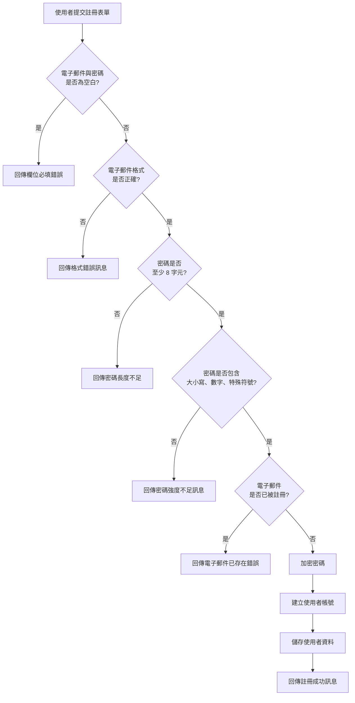
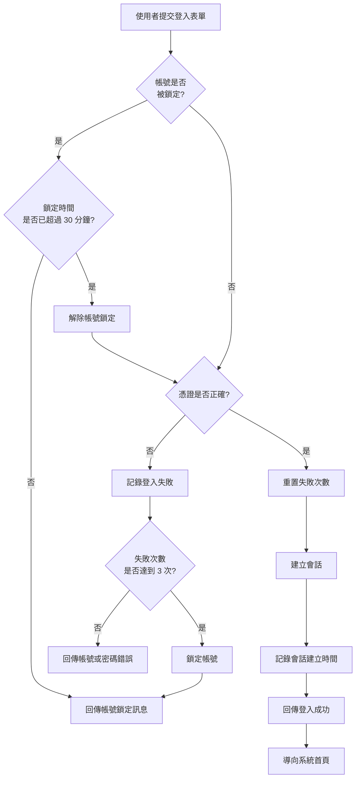
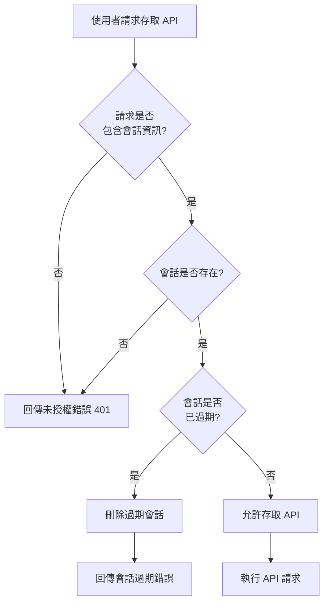

# Feature Specification Document

## Goals

建立安全且易用的使用者註冊與登入機制，讓使用者能夠透過身分驗證安全地存取 IpLocations.Api 服務，同時防護常見的安全威脅。

- 實現 > 80% 的註冊完成率與 > 90% 的首次登入成功率
- 支援身分驗證的 API 存取控制，使未授權存取嘗試下降 > 70%
- 建立使用者資料基礎，支援未來的配額管理與付費方案功能

## Background

IpLocations.Api 目前為開放式 API，任何人皆可直接呼叫服務端點，導致無法追蹤使用者、存在濫用風險、缺乏存取控制等問題。隨著服務使用量成長，這些風險將日益增加，影響服務可用性與安全性。

本功能導入使用者註冊與登入機制，讓使用者必須先建立帳號並通過身分驗證才能存取 API。透過密碼強度驗證、登入失敗防護、會話管理等安全機制，保護使用者帳號安全並防範暴力破解攻擊。此外，有了使用者身分資訊後，系統能夠精確追蹤 API 使用模式，為服務優化與商業化奠定基礎。

## Functional Requirements

### 註冊功能

- **FR-001**: 系統必須提供使用者註冊介面，要求輸入電子郵件與密碼 `[來源：prd.md#US-001]`
- **FR-002**: 系統必須驗證電子郵件欄位不可為空白 `[來源：prd.md#US-001-AC-001]`
- **FR-003**: 系統必須驗證密碼欄位不可為空白 `[來源：prd.md#US-001-AC-001]`
- **FR-004**: 系統必須驗證電子郵件格式符合標準（包含 @ 符號與網域名稱） `[來源：prd.md#US-001-AC-002]`
- **FR-005**: 系統必須拒絕少於 8 字元的密碼 `[來源：prd.md#US-001-AC-003]`
- **FR-006**: 系統必須驗證密碼包含至少一個大寫字母、一個小寫字母、一個數字與一個特殊符號 `[來源：prd.md#US-001-AC-004]`
- **FR-007**: 系統必須使用 bcrypt 演算法加密密碼後再儲存，禁止明文儲存 `[來源：prd.md#US-001-AC-007]` `[基於假設：bcrypt 在 .NET 生態系統中有成熟函式庫支援（BCrypt.Net-Next），兼顧安全性與實作便利性]`
- **FR-008**: 系統必須檢查電子郵件是否已被其他帳號使用 `[來源：prd.md#US-001-AC-005]`
- **FR-009**: 當電子郵件已存在時，系統必須回傳「此電子郵件已被註冊」錯誤訊息 `[來源：prd.md#US-001-AC-005]`
- **FR-010**: 當註冊資料驗證通過且電子郵件未重複時，系統必須建立新帳號並儲存使用者資訊（電子郵件、加密密碼、註冊日期） `[來源：prd.md#US-001-AC-006]`
- **FR-011**: 當帳號成功建立後，系統必須回傳「註冊成功」訊息 `[來源：prd.md#US-001-AC-006]`

### 登入功能

- **FR-012**: 系統必須提供使用者登入介面，要求輸入帳號（電子郵件）與密碼 `[來源：prd.md#US-002]`
- **FR-013**: 當使用者輸入正確的帳號與密碼時，系統必須建立會話並將會話資訊儲存於 Redis，利用 Redis 的 TTL 機制自動清理過期會話 `[來源：prd.md#US-002-AC-001、US-003-AC-001]` `[基於假設：系統已使用 Redis 作為快取，複用相同基礎設施可降低複雜度並提升效能]`
- **FR-014**: 當使用者成功登入時，系統必須導向至系統首頁或儀表板 `[來源：prd.md#US-002-AC-001]`
- **FR-015**: 當使用者輸入錯誤的帳號或密碼時，系統必須回傳「帳號或密碼錯誤」統一訊息，不區分帳號不存在或密碼錯誤 `[來源：prd.md#US-002-AC-002、AC-004]`
- **FR-016**: 系統必須在每次登入失敗時記錄失敗次數與時間戳記 `[來源：prd.md#US-002-AC-003]`

### 會話管理

- **FR-017**: 系統必須在會話資料中記錄建立時間、使用者識別碼與過期時間 `[來源：prd.md#US-003-AC-001]`
- **FR-018**: 會話有效期限必須設定為 7 天（604800 秒） `[來源：prd.md#US-003-AC-003、Glossary]`
- **FR-019**: 在會話有效期間內，使用者必須能夠存取 API 服務而無需重新驗證身分 `[來源：prd.md#US-003-AC-002]`
- **FR-020**: 當會話超過 7 天有效期限時，使用者嘗試存取 API 時必須收到「會話已過期，請重新登入」提示 `[來源：prd.md#US-003-AC-003]`
- **FR-021**: 當使用者執行登出操作時，系統必須立即刪除該會話並清除相關記錄 `[來源：prd.md#US-003-AC-004]`

### 暴力破解防護

- **FR-022**: 系統必須追蹤每個帳號的連續登入失敗次數 `[來源：prd.md#US-004-AC-001]`
- **FR-023**: 當同一帳號連續登入失敗達到 3 次時，系統必須鎖定該帳號並記錄鎖定時間 `[來源：prd.md#US-004-AC-001]`
- **FR-024**: 當帳號處於鎖定狀態時，使用者嘗試登入時必須收到「帳號已被鎖定，請於 30 分鐘後再試」訊息 `[來源：prd.md#US-004-AC-002]`
- **FR-025**: 系統必須在帳號鎖定 30 分鐘（1800 秒）後自動解除鎖定狀態 `[來源：prd.md#US-004-AC-003]`
- **FR-026**: 當使用者成功登入時，系統必須重置該帳號的登入失敗次數為 0 並清除所有失敗記錄 `[來源：prd.md#US-004-AC-004]` `[基於假設：成功登入表示使用者已通過驗證，過往失敗記錄應清除以避免累積過時資料]`

### 錯誤訊息

- **FR-027**: 當使用者輸入無效格式的電子郵件時，系統必須顯示「請輸入有效的電子郵件格式」 `[來源：prd.md#US-005-AC-001]`
- **FR-028**: 當密碼不符合強度要求時，系統必須顯示「密碼必須至少 8 字元，並包含大寫字母、小寫字母、數字與特殊符號」 `[來源：prd.md#US-005-AC-002]`
- **FR-029**: 當電子郵件已被註冊時，系統必須顯示「此電子郵件已被註冊，請使用其他電子郵件或直接登入」 `[來源：prd.md#US-005-AC-003]`
- **FR-030**: 所有錯誤訊息必須以繁體中文顯示，語氣友善且具建設性 `[來源：prd.md#US-005-AC-004]`

### 個人資料查看

- **FR-031**: 在已登入狀態期間，系統必須提供個人資料頁面供使用者存取 `[來源：prd.md#US-006-AC-001]`
- **FR-032**: 個人資料頁面必須顯示使用者的電子郵件與註冊日期 `[來源：prd.md#US-006-AC-002]`
- **FR-033**: 個人資料頁面必須不顯示密碼資訊，僅提供修改密碼的連結 `[來源：prd.md#US-006-AC-003]`

## Non-Functional Requirements

- **NFR-001**: 系統應在 95% 的情況下於 200ms 內完成註冊與登入請求處理（不含網路延遲）`[基於假設：參考業界標準 Web 應用程式回應時間要求]`
- **NFR-002**: 密碼驗證邏輯應能抵抗時序攻擊（timing attack），確保驗證時間不因密碼正確與否而產生可識別的差異 `[基於假設：參考 OWASP 身分驗證安全最佳實務]`
- **NFR-003**: 會話識別碼必須使用密碼學安全的隨機數生成器產生，長度至少 128 位元 `[基於假設：參考 OWASP Session Management 指引]`
- **NFR-004**: 系統應記錄所有登入嘗試（成功與失敗）、帳號鎖定與解鎖事件，以供安全稽核使用 `[基於假設：企業級服務的稽核追蹤要求]`
- **NFR-005**: 使用者資料（包含加密密碼、登入失敗記錄、會話資料）應於帳號活躍期間永久保留，未來版本將提供使用者主動刪除帳號功能 `[來源：prd.md#Glossary-資料保留政策]`
- **NFR-006**: 註冊與登入介面應支援常見瀏覽器（Chrome、Firefox、Edge、Safari 最新兩個主要版本） `[基於假設：參考主流 Web 應用程式瀏覽器支援標準]`

## System Flow

### 註冊流程


### 登入流程


### 會話驗證流程


## Feature Scenarios

### US-001 - 使用者註冊帳號 (Priority: P1)

- **SCN-001** `[對應：AC-001]`
```gherkin
Scenario: 註冊時電子郵件與密碼皆為空白
  Given 使用者位於註冊頁面
  When 使用者提交空白的電子郵件與密碼
  Then 系統應顯示「電子郵件與密碼為必填欄位」錯誤訊息
  And 註冊表單保持顯示
```

- **SCN-002** `[對應：AC-001]`
```gherkin
Scenario: 註冊時僅電子郵件為空白
  Given 使用者位於註冊頁面
  When 使用者輸入密碼 "SecurePass123!" 但電子郵件留空
  Then 系統應顯示「電子郵件為必填欄位」錯誤訊息
  And 註冊表單保持顯示
```

- **SCN-003** `[對應：AC-001]`
```gherkin
Scenario: 註冊時僅密碼為空白
  Given 使用者位於註冊頁面
  When 使用者輸入電子郵件 "user@example.com" 但密碼留空
  Then 系統應顯示「密碼為必填欄位」錯誤訊息
  And 註冊表單保持顯示
```

- **SCN-004** `[對應：AC-002]`
```gherkin
Scenario: 註冊時電子郵件缺少 @ 符號
  Given 使用者位於註冊頁面
  When 使用者輸入電子郵件 "userexample.com"
  And 使用者輸入密碼 "SecurePass123!"
  Then 系統應顯示「請輸入有效的電子郵件格式」錯誤訊息
```

- **SCN-005** `[對應：AC-002]`
```gherkin
Scenario: 註冊時電子郵件缺少網域名稱
  Given 使用者位於註冊頁面
  When 使用者輸入電子郵件 "user@"
  And 使用者輸入密碼 "SecurePass123!"
  Then 系統應顯示「請輸入有效的電子郵件格式」錯誤訊息
```

- **SCN-006** `[對應：AC-002]`
```gherkin
Scenario: 註冊時使用有效的電子郵件格式
  Given 使用者位於註冊頁面
  And 電子郵件 "user@example.com" 尚未被註冊
  When 使用者輸入電子郵件 "user@example.com"
  And 使用者輸入密碼 "SecurePass123!"
  Then 系統應接受電子郵件格式並繼續驗證其他欄位
```

- **SCN-007** `[對應：AC-003]`
```gherkin
Scenario: 註冊時密碼少於 8 字元
  Given 使用者位於註冊頁面
  When 使用者輸入電子郵件 "user@example.com"
  And 使用者輸入密碼 "Pass1!"
  Then 系統應顯示「密碼必須至少 8 字元，並包含大寫字母、小寫字母、數字與特殊符號」錯誤訊息
```

- **SCN-008** `[對應：AC-003]`
```gherkin
Scenario: 註冊時密碼恰好 8 字元且符合強度要求
  Given 使用者位於註冊頁面
  And 電子郵件 "user@example.com" 尚未被註冊
  When 使用者輸入電子郵件 "user@example.com"
  And 使用者輸入密碼 "Secure1!"
  Then 系統應接受密碼並繼續驗證其他欄位
```

- **SCN-009** `[對應：AC-004]`
```gherkin
Scenario: 註冊時密碼缺少大寫字母
  Given 使用者位於註冊頁面
  When 使用者輸入電子郵件 "user@example.com"
  And 使用者輸入密碼 "securepass123!"
  Then 系統應顯示「密碼必須至少 8 字元，並包含大寫字母、小寫字母、數字與特殊符號」錯誤訊息
```

- **SCN-010** `[對應：AC-004]`
```gherkin
Scenario: 註冊時密碼缺少小寫字母
  Given 使用者位於註冊頁面
  When 使用者輸入電子郵件 "user@example.com"
  And 使用者輸入密碼 "SECUREPASS123!"
  Then 系統應顯示「密碼必須至少 8 字元，並包含大寫字母、小寫字母、數字與特殊符號」錯誤訊息
```

- **SCN-011** `[對應：AC-004]`
```gherkin
Scenario: 註冊時密碼缺少數字
  Given 使用者位於註冊頁面
  When 使用者輸入電子郵件 "user@example.com"
  And 使用者輸入密碼 "SecurePass!"
  Then 系統應顯示「密碼必須至少 8 字元，並包含大寫字母、小寫字母、數字與特殊符號」錯誤訊息
```

- **SCN-012** `[對應：AC-004]`
```gherkin
Scenario: 註冊時密碼缺少特殊符號
  Given 使用者位於註冊頁面
  When 使用者輸入電子郵件 "user@example.com"
  And 使用者輸入密碼 "SecurePass123"
  Then 系統應顯示「密碼必須至少 8 字元，並包含大寫字母、小寫字母、數字與特殊符號」錯誤訊息
```

- **SCN-013** `[對應：AC-004]`
```gherkin
Scenario: 註冊時密碼符合所有強度要求
  Given 使用者位於註冊頁面
  And 電子郵件 "user@example.com" 尚未被註冊
  When 使用者輸入電子郵件 "user@example.com"
  And 使用者輸入密碼 "SecurePass123!"
  Then 系統應接受密碼並繼續驗證其他欄位
```

- **SCN-014** `[對應：AC-005]`
```gherkin
Scenario: 註冊時電子郵件已被其他帳號使用
  Given 系統中已存在帳號使用電子郵件 "existing@example.com"
  And 使用者位於註冊頁面
  When 使用者輸入電子郵件 "existing@example.com"
  And 使用者輸入密碼 "SecurePass123!"
  Then 系統應顯示「此電子郵件已被註冊，請使用其他電子郵件或直接登入」錯誤訊息
  And 帳號不應被建立
```

- **SCN-015** `[對應：AC-006]`
```gherkin
Scenario: 成功註冊新帳號
  Given 使用者位於註冊頁面
  And 電子郵件 "newuser@example.com" 尚未被註冊
  When 使用者輸入電子郵件 "newuser@example.com"
  And 使用者輸入密碼 "SecurePass123!"
  And 使用者提交註冊表單
  Then 系統應建立新帳號
  And 系統應顯示「註冊成功」訊息
  And 使用者資料應包含電子郵件、加密密碼與註冊日期
```

- **SCN-016** `[對應：AC-007]`
```gherkin
Scenario: 驗證密碼以加密方式儲存
  Given 使用者成功註冊帳號
  And 使用者輸入的密碼為 "SecurePass123!"
  When 系統管理員檢查資料庫中的密碼欄位
  Then 密碼應為加密格式，而非明文 "SecurePass123!"
  And 加密密碼長度應大於原始密碼長度
```

### US-002 - 使用者安全登入 (Priority: P1)

- **SCN-017** `[對應：AC-001]`
```gherkin
Scenario: 使用正確的帳號與密碼登入
  Given 系統中存在帳號 "user@example.com"，密碼為 "SecurePass123!"
  And 該帳號未被鎖定
  And 使用者位於登入頁面
  When 使用者輸入帳號 "user@example.com"
  And 使用者輸入密碼 "SecurePass123!"
  And 使用者提交登入表單
  Then 系統應建立會話
  And 系統應導向至系統首頁
```

- **SCN-018** `[對應：AC-002]`
```gherkin
Scenario: 使用不存在的帳號登入
  Given 系統中不存在帳號 "nonexistent@example.com"
  And 使用者位於登入頁面
  When 使用者輸入帳號 "nonexistent@example.com"
  And 使用者輸入密碼 "AnyPassword123!"
  And 使用者提交登入表單
  Then 系統應顯示「帳號或密碼錯誤」訊息
  And 不應建立會話
```

- **SCN-019** `[對應：AC-002]`
```gherkin
Scenario: 使用錯誤的密碼登入
  Given 系統中存在帳號 "user@example.com"，密碼為 "SecurePass123!"
  And 該帳號未被鎖定
  And 使用者位於登入頁面
  When 使用者輸入帳號 "user@example.com"
  And 使用者輸入密碼 "WrongPassword!"
  And 使用者提交登入表單
  Then 系統應顯示「帳號或密碼錯誤」訊息
  And 不應建立會話
```

- **SCN-020** `[對應：AC-003]`
```gherkin
Scenario: 登入失敗時記錄失敗次數
  Given 系統中存在帳號 "user@example.com"
  And 該帳號目前無登入失敗記錄
  And 使用者位於登入頁面
  When 使用者輸入帳號 "user@example.com"
  And 使用者輸入錯誤密碼
  And 使用者提交登入表單
  Then 系統應記錄該帳號的登入失敗次數為 1
  And 系統應記錄失敗時間戳記
```

- **SCN-021** `[對應：AC-004]`
```gherkin
Scenario: 帳號不存在與密碼錯誤的錯誤訊息一致
  Given 使用者位於登入頁面
  When 使用者嘗試以不存在的帳號登入
  Then 系統應顯示「帳號或密碼錯誤」訊息
  When 使用者嘗試以存在的帳號但錯誤密碼登入
  Then 系統應顯示相同的「帳號或密碼錯誤」訊息
  And 兩種情況的錯誤訊息應完全一致，無法區分
```

### US-003 - 會話管理與自動登出 (Priority: P1)

- **SCN-022** `[對應：AC-001]`
```gherkin
Scenario: 成功登入後建立會話並記錄時間
  Given 系統中存在帳號 "user@example.com"
  And 使用者成功登入
  When 系統建立會話
  Then 會話資料應包含建立時間
  And 會話資料應包含使用者識別碼
  And 會話資料應包含過期時間（建立時間 + 7 天）
```

- **SCN-023** `[對應：AC-002]`
```gherkin
Scenario: 在會話有效期間內存取 API
  Given 使用者已成功登入
  And 會話建立於 2 天前
  And 會話尚未過期
  When 使用者請求存取 API 端點 "/api/iplocations/query"
  Then 系統應允許存取而無需重新登入
  And API 應正常回應查詢結果
```

- **SCN-024** `[對應：AC-002]`
```gherkin
Scenario: 在會話有效期間內多次存取 API
  Given 使用者已成功登入
  And 會話建立於 5 天前
  And 會話尚未過期
  When 使用者連續請求存取 API 10 次
  Then 每次請求都應允許存取而無需重新登入
  And 會話應保持有效狀態
```

- **SCN-025** `[對應：AC-003]`
```gherkin
Scenario: 會話超過 7 天有效期後嘗試存取 API
  Given 使用者已成功登入
  And 會話建立於 8 天前
  When 使用者請求存取 API 端點 "/api/iplocations/query"
  Then 系統應拒絕存取
  And 系統應顯示「會話已過期，請重新登入」訊息
  And 系統應回傳 HTTP 401 未授權狀態碼
```

- **SCN-026** `[對應：AC-003]`
```gherkin
Scenario: 會話恰好在 7 天有效期邊界時嘗試存取
  Given 使用者已成功登入
  And 會話建立於恰好 7 天前（604800 秒）
  When 使用者請求存取 API
  Then 系統應拒絕存取
  And 系統應顯示「會話已過期，請重新登入」訊息
```

- **SCN-027** `[對應：AC-004]`
```gherkin
Scenario: 使用者執行登出操作
  Given 使用者已成功登入
  And 會話目前處於有效狀態
  When 使用者點擊登出按鈕
  Then 系統應立即刪除該使用者的會話
  And 系統應導向至登入頁面
  And 使用者應無法再使用該會話存取 API
```

- **SCN-028** `[對應：AC-004]`
```gherkin
Scenario: 登出後嘗試存取 API
  Given 使用者原先已成功登入
  And 使用者已執行登出操作
  When 使用者嘗試使用原會話資訊存取 API
  Then 系統應拒絕存取
  And 系統應顯示「未授權，請重新登入」訊息
```

### US-004 - 防護暴力破解攻擊 (Priority: P1)

- **SCN-029** `[對應：AC-001]`
```gherkin
Scenario: 連續登入失敗 3 次後帳號被鎖定
  Given 系統中存在帳號 "user@example.com"
  And 該帳號未被鎖定
  And 使用者位於登入頁面
  When 使用者連續 3 次輸入錯誤密碼並提交
  Then 系統應鎖定帳號 "user@example.com"
  And 系統應記錄鎖定時間
```

- **SCN-030** `[對應：AC-001]`
```gherkin
Scenario: 登入失敗 2 次後尚未鎖定
  Given 系統中存在帳號 "user@example.com"
  And 該帳號未被鎖定
  When 使用者連續 2 次輸入錯誤密碼並提交
  Then 系統應不鎖定帳號
  And 系統應記錄失敗次數為 2
  And 使用者仍可嘗試登入
```

- **SCN-031** `[對應：AC-002]`
```gherkin
Scenario: 嘗試登入已鎖定的帳號
  Given 系統中存在帳號 "user@example.com"
  And 該帳號已被鎖定
  And 鎖定時間尚未超過 30 分鐘
  When 使用者輸入正確的帳號與密碼
  And 使用者提交登入表單
  Then 系統應顯示「帳號已被鎖定，請於 30 分鐘後再試」訊息
  And 不應建立會話
```

- **SCN-032** `[對應：AC-002]`
```gherkin
Scenario: 已鎖定帳號在鎖定期間內嘗試多次登入
  Given 系統中存在帳號 "user@example.com"
  And 該帳號已被鎖定
  And 鎖定時間尚未超過 30 分鐘
  When 使用者嘗試登入 5 次
  Then 每次嘗試都應顯示「帳號已被鎖定，請於 30 分鐘後再試」訊息
  And 鎖定狀態應保持不變
```

- **SCN-033** `[對應：AC-003]`
```gherkin
Scenario: 帳號鎖定 30 分鐘後自動解除
  Given 系統中存在帳號 "user@example.com"
  And 該帳號於 31 分鐘前被鎖定
  When 使用者輸入正確的帳號與密碼
  And 使用者提交登入表單
  Then 系統應自動解除鎖定狀態
  And 系統應允許登入並建立會話
```

- **SCN-034** `[對應：AC-003]`
```gherkin
Scenario: 帳號鎖定恰好 30 分鐘時嘗試登入
  Given 系統中存在帳號 "user@example.com"
  And 該帳號於恰好 30 分鐘前（1800 秒）被鎖定
  When 使用者輸入正確的帳號與密碼
  And 使用者提交登入表單
  Then 系統應解除鎖定狀態
  And 系統應允許登入並建立會話
```

- **SCN-035** `[對應：AC-004]`
```gherkin
Scenario: 成功登入後重置失敗次數
  Given 系統中存在帳號 "user@example.com"
  And 該帳號登入失敗次數為 2
  And 該帳號未被鎖定
  When 使用者輸入正確的帳號與密碼並成功登入
  Then 系統應重置該帳號的登入失敗次數為 0
  And 系統應建立會話
```

- **SCN-036** `[對應：AC-004]`
```gherkin
Scenario: 鎖定期滿後成功登入應重置失敗次數
  Given 系統中存在帳號 "user@example.com"
  And 該帳號因連續失敗 3 次而被鎖定
  And 鎖定時間已超過 30 分鐘
  When 使用者輸入正確的帳號與密碼並成功登入
  Then 系統應解除鎖定狀態
  And 系統應重置登入失敗次數為 0
  And 系統應建立會話
```

### US-005 - 明確的錯誤訊息提示 (Priority: P2)

- **SCN-037** `[對應：AC-001]`
```gherkin
Scenario: 提交無效格式的電子郵件
  Given 使用者位於註冊頁面
  When 使用者輸入電子郵件 "invalid-email"
  And 使用者輸入密碼 "SecurePass123!"
  And 使用者提交表單
  Then 系統應顯示「請輸入有效的電子郵件格式」錯誤訊息
  And 錯誤訊息應以繁體中文顯示
```

- **SCN-038** `[對應：AC-002]`
```gherkin
Scenario: 密碼不符合強度要求時顯示具體規則
  Given 使用者位於註冊頁面
  When 使用者輸入電子郵件 "user@example.com"
  And 使用者輸入密碼 "weak"
  And 使用者提交表單
  Then 系統應顯示「密碼必須至少 8 字元，並包含大寫字母、小寫字母、數字與特殊符號」錯誤訊息
  And 錯誤訊息應以繁體中文顯示
```

- **SCN-039** `[對應：AC-003]`
```gherkin
Scenario: 嘗試註冊已存在的電子郵件
  Given 系統中已存在帳號 "existing@example.com"
  And 使用者位於註冊頁面
  When 使用者輸入電子郵件 "existing@example.com"
  And 使用者輸入密碼 "SecurePass123!"
  And 使用者提交表單
  Then 系統應顯示「此電子郵件已被註冊，請使用其他電子郵件或直接登入」錯誤訊息
  And 錯誤訊息應以繁體中文顯示
  And 訊息語氣應友善且提供建設性建議
```

- **SCN-040** `[對應：AC-004]`
```gherkin
Scenario: 所有錯誤訊息以繁體中文顯示
  Given 使用者位於註冊或登入頁面
  When 系統偵測到任何錯誤情況
  Then 所有錯誤訊息應使用繁體中文
  And 不應出現英文或簡體中文錯誤訊息
  And 訊息語氣應友善且具建設性
```

### US-006 - 查看註冊使用者資訊 (Priority: P3)

- **SCN-041** `[對應：AC-001]`
```gherkin
Scenario: 已登入使用者存取個人資料頁面
  Given 使用者已成功登入
  And 會話處於有效狀態
  When 使用者前往個人資料頁面
  Then 系統應顯示個人資料頁面內容
  And 頁面應包含使用者的基本資訊
```

- **SCN-042** `[對應：AC-001]`
```gherkin
Scenario: 未登入使用者嘗試存取個人資料頁面
  Given 使用者尚未登入
  When 使用者嘗試直接存取個人資料頁面 URL
  Then 系統應拒絕存取
  And 系統應導向至登入頁面
```

- **SCN-043** `[對應：AC-002]`
```gherkin
Scenario: 個人資料頁面顯示電子郵件與註冊日期
  Given 使用者 "user@example.com" 於 2025-10-15 註冊
  And 使用者已成功登入
  When 使用者前往個人資料頁面
  Then 頁面應顯示電子郵件 "user@example.com"
  And 頁面應顯示註冊日期 "2025-10-15"
```

- **SCN-044** `[對應：AC-003]`
```gherkin
Scenario: 個人資料頁面不顯示密碼資訊
  Given 使用者已成功登入
  When 使用者前往個人資料頁面
  Then 頁面應不顯示使用者的密碼（無論明文或加密）
  And 頁面應提供「修改密碼」連結或按鈕
  And 點擊「修改密碼」連結應導向至修改密碼頁面（未來實作）
```

## Key Entities

- **User (使用者)**：註冊於系統中的帳號實體，包含唯一識別碼、電子郵件、加密密碼、註冊日期、帳號狀態（正常/鎖定）等屬性。代表能夠登入並存取 API 服務的個體。

- **Session (會話)**：使用者成功登入後產生的臨時狀態記錄，包含會話識別碼、使用者識別碼、建立時間、過期時間等屬性。會話用於追蹤使用者的已驗證狀態，避免每次 API 請求都需要重新驗證帳號密碼。會話與使用者為一對多關係（一個使用者可同時擁有多個有效會話）。

- **LoginAttempt (登入嘗試記錄)**：記錄使用者登入嘗試的事件，包含帳號識別碼、嘗試時間、成功或失敗狀態。用於追蹤登入失敗次數以實現暴力破解防護機制。當同一帳號累積 3 次失敗記錄時觸發帳號鎖定。

- **AccountLockout (帳號鎖定)**：當登入失敗次數達到門檻時產生的狀態記錄，包含帳號識別碼、鎖定時間、解鎖時間等屬性。鎖定期間拒絕該帳號的所有登入嘗試，30 分鐘後自動解除。與使用者為一對一關係（一個使用者最多同時有一筆有效的鎖定記錄）。

## Dependencies

### 外部服務相依性
- **電子郵件驗證服務（未來規劃）**：若未來版本實作電子郵件驗證功能，需整合 SMTP 服務或第三方郵件發送服務（如 SendGrid、AWS SES）

### 內部團隊相依性
- **Redis 服務**：會話資料與登入失敗記錄建議儲存於 Redis，需確保 Redis 服務穩定運行且具備 TTL 過期機制
- **資料庫團隊**：需建立使用者資料表與相關索引，確保電子郵件唯一性約束與密碼欄位加密儲存
- **前端團隊**：需實作註冊與登入表單介面，正確處理 API 回應的錯誤訊息與會話資訊

### 先決工作
- 確認密碼加密演算法選擇與相關函式庫導入
- 設計資料庫 schema（使用者資料表、登入記錄資料表）
- 規劃會話儲存機制（Redis key 命名規則、過期策略）
- 制定 API 端點規格（註冊、登入、登出、個人資料查詢）

## Definition of Done (DoD)

- [ ] 所有需求均已實作並通過驗收標準
- [ ] 所有 Feature Scenarios（SCN-001 至 SCN-044）已實作對應測試並通過
- [ ] 單元測試覆蓋率達 80% 以上，涵蓋密碼驗證、加密、會話管理、鎖定機制等核心邏輯
- [ ] 整合測試已驗證註冊、登入、會話驗證、帳號鎖定與解鎖等完整流程
- [ ] 安全性測試已驗證：密碼加密儲存、會話識別碼隨機性、時序攻擊防護、帳號枚舉防護
- [ ] 相關文件已更新且完整：API 文件、資料庫 schema、部署指南
- [ ] 程式碼已通過 Code Review 並獲得批准
- [ ] 無重大缺陷或阻礙問題（P0/P1 優先級 Bug 已修復）
- [ ] 已完成效能測試，確認註冊與登入回應時間符合 NFR-001（< 200ms）
- [ ] 部署流程已驗證且可順利執行，包含資料庫遷移與 Redis 設定
- [ ] 使用者手冊或 API 使用指引已提供，說明註冊與登入流程
- [ ] 已補充「待補充資訊」章節中的未決議項目，或確認可接受預設方案
