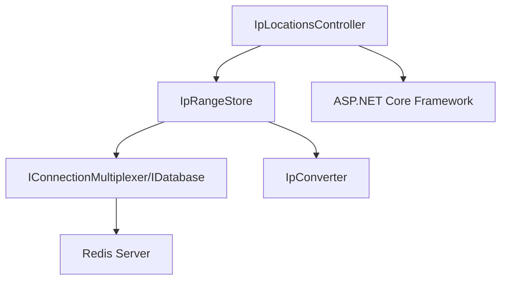
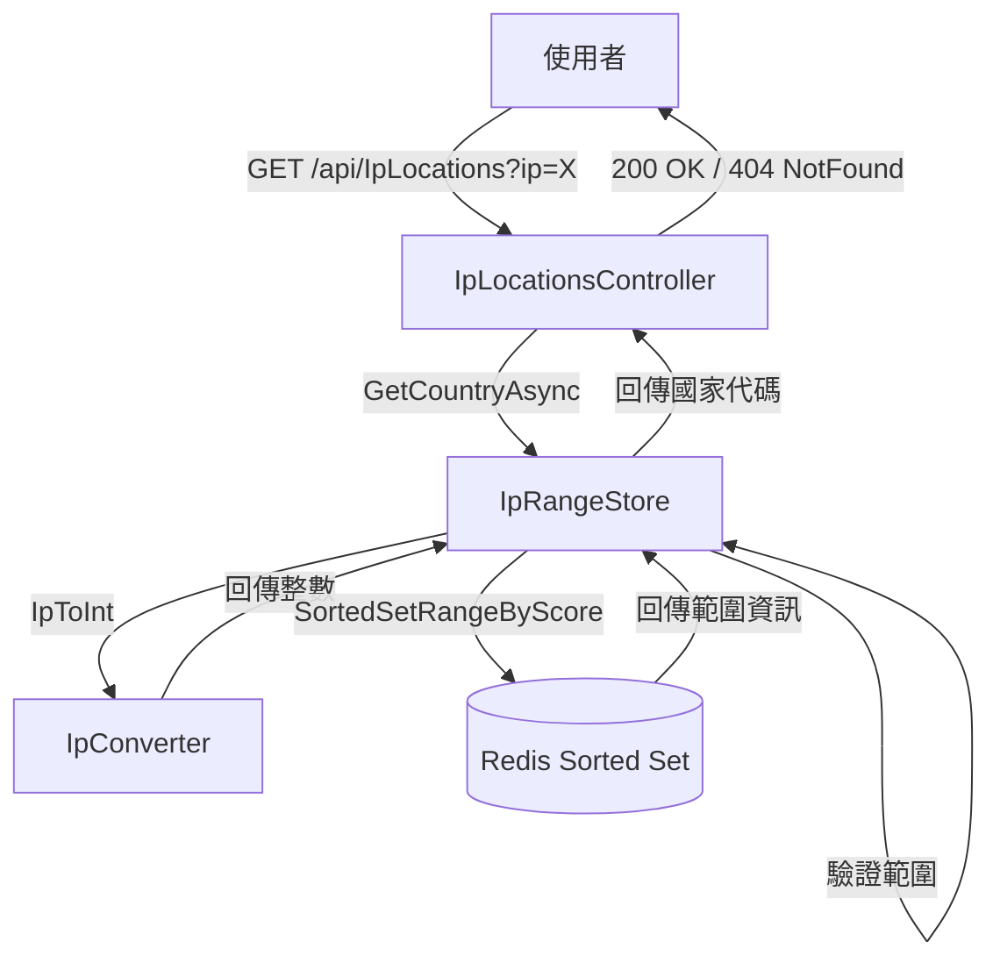

# Application Architecture

## 版本歷史

| 日期       | 版本 | 變更摘要 | 作者 |
| ---------- | ---- | -------- | ---- |
| 2025-10-31 | 1.0  | 初始建立 | AI   |

## Application Architecture (High-Level Design)

### 核心架構
- **架構風格**：單體式 (Monolithic) Web API 應用程式
- **邏輯層次**：
  - **Presentation Layer**：Controllers（API 端點）
  - **Business Logic Layer**：Service 層（IpRangeStore）
  - **Infrastructure Layer**：Redis 資料存取、工具類別
- **模組互動方式**：同步 HTTP 請求/回應，內部使用非同步 I/O（async/await）

### 橫切關注點
- **安全性邊界**：目前無驗證機制，開放存取
- **監控與日誌**：使用 ASP.NET Core 內建日誌系統
- **錯誤處理**：Controller 層處理，回傳標準 HTTP 狀態碼（200 OK、404 NotFound）

### 部署架構
- **部署單元**：Docker 容器
- **部署架構**：單區域部署，可依需求進行水平擴展
- **依賴服務**：Redis（外部服務）

## Module Boundaries

- **Controllers 與 Services**：Controllers 負責 HTTP 請求處理與回應，Services（IpRangeStore）封裝業務邏輯與資料存取
- **Services 與 Infrastructure**：Services 透過 Redis 客戶端（IDatabase）進行資料查詢，不直接操作底層儲存細節
- **公開 API 與內部邏輯**：公開 API 定義於 Controllers，內部邏輯封裝於 Services 與 Utilities
- **依賴方向**：Controllers → Services → Infrastructure，遵循由外向內的依賴方向
- **工具類別**：Misc/ 目錄下的工具類別（如 IpConverter）可被 Services 使用，不依賴業務邏輯

## System Dependency Direction

## Data Model and Flow

- **核心實體**：
  - **IP 範圍 (IP Range)**：由起始 IP、結束 IP、國家代碼組成
  - **IP 位址 (IP Address)**：使用者查詢的 IPv4 位址
  - **國家代碼 (Country Code)**：兩位字母國家代碼（ISO 3166-1 alpha-2）

- **資料流動**：
  1. 使用者發送 HTTP GET 請求至 `/api/IpLocations?ip={ipAddress}`
  2. IpLocationsController 接收請求，呼叫 IpRangeStore.GetCountryAsync()
  3. IpConverter 將 IP 字串轉換為整數
  4. IpRangeStore 計算 Redis 分區 key
  5. 使用 SortedSetRangeByScore 查詢最接近的 IP 範圍（降序，取一筆）
  6. 驗證 IP 是否落在查詢到的範圍內
  7. 回傳國家代碼或空字串
  8. Controller 根據結果回傳 200 OK 或 404 NotFound

## Data Storage Strategy

### Redis Sorted Set 設計

- **分區策略**：將 IP 數值轉為 10 位數字（補零），取前三位作為分區依據
  - 範例：IP `192.168.0.1` → 整數 `3232235521` → 補零 `0003232235521` → 分區 `000`
  - Redis Key 格式：`ip-to-country:range-{partition}`
  
- **Sorted Set 結構**：
  - **Score**：IP 範圍起始值（整數）
  - **Member**：`{startIp}-{endIp}:{countryCode}` 格式的字串
  
- **查詢演算法**：
  1. 計算查詢 IP 的整數值與分區
  2. 使用 `SortedSetRangeByScore` 查詢小於等於該 IP 的最大值（降序，取一筆）
  3. 解析回傳的範圍資訊，驗證 IP 是否在範圍內
  4. 若在範圍內則回傳國家代碼，否則回傳空字串

### 初始化機制

- 應用程式啟動時呼叫 `IpRangeStore.WarmUp()` 載入預設 IP 範圍資料
- 目前採用硬編碼方式，未來可改為從檔案載入

## Error Handling and Retry Strategy

| 錯誤層級     | 範例                     | 回應策略           | 重試規則 |
| ------------ | ------------------------ | ------------------ | -------- |
| 輸入驗證錯誤 | 無效的 IP 格式           | 回傳 404 NotFound  | 不重試   |
| 查詢無結果   | IP 不在任何已知範圍內    | 回傳 404 NotFound  | 不重試   |
| Redis 連線錯誤 | Redis 伺服器無法連線   | 拋出例外           | 不重試   |

## Configuration Management

- **集中式組態**：使用 appsettings.json 管理組態
- **環境分離**：
  - Development：使用 appsettings.Development.json，包含本地 Redis 連線字串
  - Production：透過環境變數或外部組態服務提供
- **安全性**：
  - Redis 密碼存放於組態檔（開發環境）或環境變數（生產環境）
  - 使用 User Secrets 保護開發環境的敏感資訊
- **動態更新**：目前不支援動態更新組態，需重新啟動應用程式
- **版本控制**：appsettings.json 納入版本控制，appsettings.Development.json 可選擇性忽略

## API Design

### 端點設計

- **GET /api/IpLocations**
  - **查詢參數**：`ip` (string, required) - IPv4 位址
  - **成功回應**：200 OK，回傳國家代碼（純文字）
  - **失敗回應**：404 NotFound，IP 格式無效或無對應資料

### Swagger/OpenAPI

- 開發環境自動啟用 Swagger UI（路徑：`/swagger`）
- 提供互動式 API 測試介面
